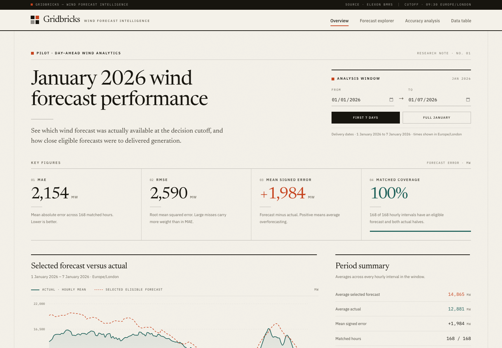
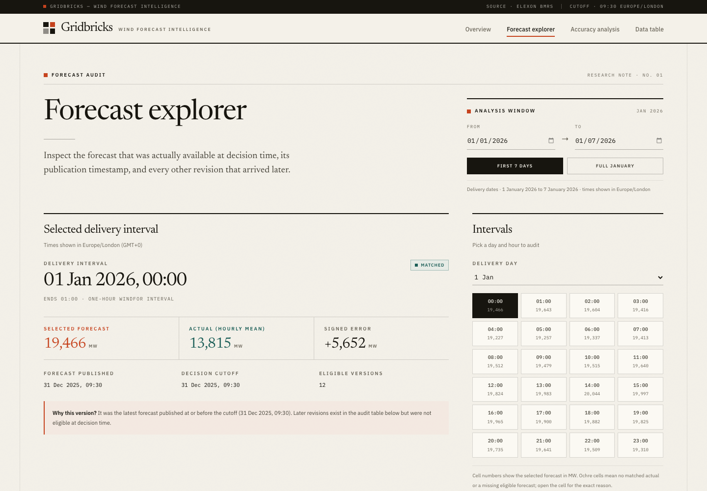
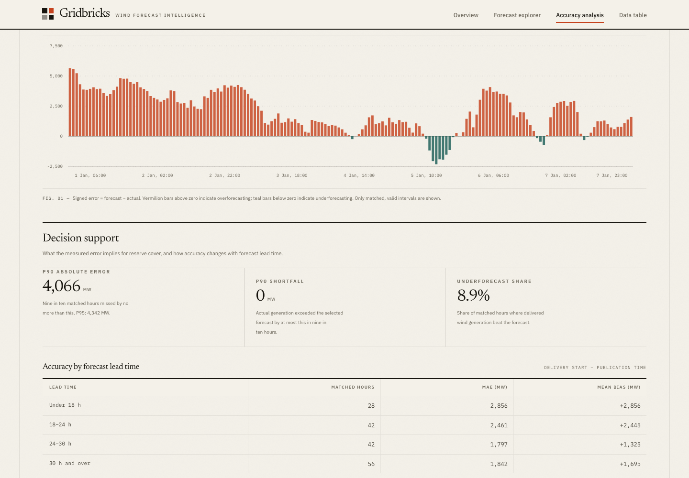
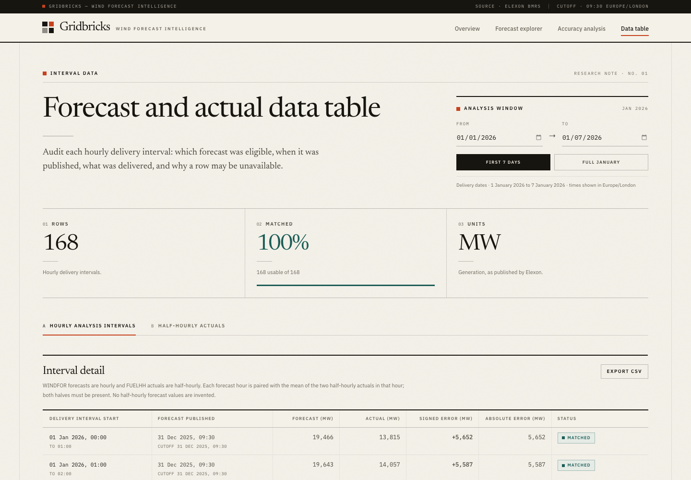
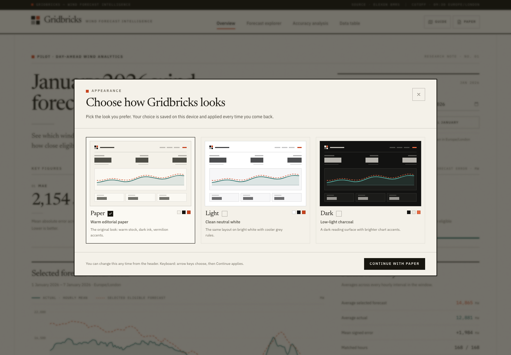
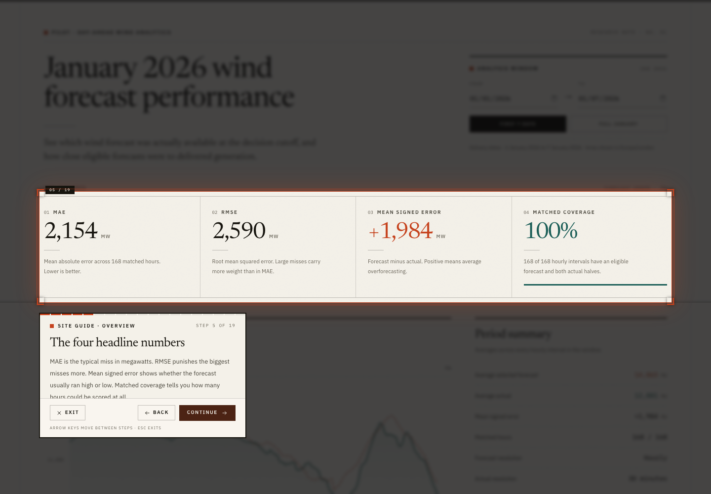
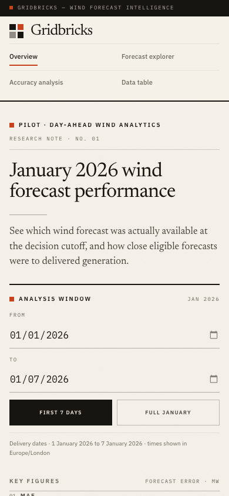
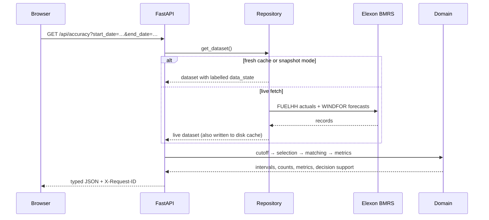

<div align="center">

# Gridbricks

**A look-ahead-free wind-forecast audit bench on real Elexon data.**

Gridbricks reconstructs what a GB day-ahead procurement desk could actually
have known: the latest WINDFOR wind forecast published at or before the
09:30 Europe/London cutoff, and the measured error against delivered
half-hourly FUELHH generation. Every selected version, excluded revision,
missing value, and failed request is visible and traceable.

[](https://github.com/GauravKaloliya/Gridbricks/actions/workflows/ci.yml)
[](LICENSE)
[](https://www.python.org/)
[](https://react.dev/)
[](https://www.typescriptlang.org/)
[](https://fastapi.tiangolo.com/)
[](docs/deployment.md)
[](#docker)

[At a glance](#at-a-glance) · [Results](#results-on-real-data) · [Quickstart](#quickstart) · [Architecture](#architecture) · [Frontend](#frontend-deep-dive) · [Backend](#backend-deep-dive) · [API](#api-reference) · [Performance](#performance) · [Testing](#testing-and-evidence) · [Docs](#documentation)

</div>



> All quantitative claims in this README were measured on **29 October 2026**
> against the bundled January 2026 snapshot, the local Docker stack, or the
> hosted GitHub Actions run cited in each table. The hosted Vercel deployment
> has **not** been performed; no public URL is claimed. See
> [Deployment status](#deployment-status).

---

## Contents

| | | |
| --- | --- | --- |
| [At a glance](#at-a-glance) | [Why this exists](#why-this-exists) | [Results on real data](#results-on-real-data) |
| [Product tour](#product-tour) | [Technology stack](#technology-stack) | [Quickstart](#quickstart) |
| [Deployment](#deployment) | [Architecture](#architecture) | [Frontend deep dive](#frontend-deep-dive) |
| [Themes](#themes) | [Site guide](#site-guide) | [Accessibility](#accessibility-and-responsiveness) |
| [Backend deep dive](#backend-deep-dive) | [Data engineering](#data-engineering) | [Methods and correctness](#methods-and-correctness) |
| [API reference](#api-reference) | [Performance](#performance) | [Testing and evidence](#testing-and-evidence) |
| [Repository guide](#repository-guide) | [Configuration](#configuration) | [Docker](#docker) |
| [Engineering decisions](#engineering-decisions) | [Requirement traceability](#requirement-traceability) | [Failure modes](#failure-modes) |
| [Known limitations](#known-limitations) | [Roadmap](#roadmap) | [FAQ](#faq) |
| [AI disclosure](#ai-development-disclosure) | [Documentation](#documentation) | [License](#license) |

---

## At a glance

| | |
| --- | --- |
| **Product** | Audit and accuracy analytics for day-ahead wind procurement. Not a dispatch or procurement optimiser. |
| **Hard invariants** | No look-ahead: only `publishTime <= cutoff` is selectable. No fabrication: missing values stay `null`, failures stay visible. |
| **Data** | Real Elexon BMRS data — FUELHH half-hourly WIND actuals and WINDFOR hourly forecast revisions. No synthetic observations. |
| **Period** | January 2026: 744 hourly delivery intervals, 1,488 half-hourly actuals, 18,104 forecast revisions. |
| **Default cutoff** | 09:30 Europe/London on the previous calendar day, inclusive. Configurable and documented as an assumption. |
| **Frontend** | React 19.3, TypeScript 5.9, Vite 6.4, TanStack Query 5.105, React Router 6.30, Recharts 2.15, Tailwind CSS 3.4. |
| **Backend** | Python 3.12, FastAPI 0.115, Pydantic 2, httpx, Uvicorn. Pure domain layer, typed OpenAPI contract. |
| **Storage** | No database. A 2,511,322-byte provenance-stamped snapshot plus an optional 7-day disk cache. |
| **Experience** | Three themes (Paper, Light, Dark) with a first-visit chooser and live preview; a 19-step site guide that freezes the page and spotlights each control. |
| **Result** | 744 / 744 intervals matched; MAE **2,122.81 MW**, RMSE **2,616.69 MW**, MBE **+1,840.30 MW**. |
| **Verification** | 80 backend tests, 47 frontend unit tests, 22 E2E tests across 3 browsers (66 runs), axe clean on four routes plus the chooser, guide and dark theme, HTML landing page axe clean in light and dark, Docker smoke, hosted CI green on pushed commit `a75e631` (78 backend tests at that point). |
| **Deployment** | Vercel Services config committed and exercised locally; Docker/Render/Heroku paths documented. **Not publicly deployed.** |
| **License** | MIT. Data attribution: public Elexon BMRS data. |

### Project scale

| Area | Lines | Detail |
| --- | ---: | --- |
| Python application | 2,746 | 4 domain modules, 3 data modules, 5 core modules, API, services, schemas, landing page, 2 entrypoints |
| Python tests | 1,258 | 80 tests across 11 files |
| Frontend TypeScript/TSX | 5,466 | 5 pages, 22 components, 3 providers, query hooks, typed API client, formatting, CSV, theme palettes, guide steps |
| Frontend tests | 1,012 | 47 tests across 11 files |
| Stylesheet | 481 | Tailwind layers, editorial typography, responsive table-to-card rules, theme tokens, guide spotlight |
| E2E specs | 642 | 6 analysis flows, 9 theme and guide flows, 7 axe checks |
| Documentation | 4,070 | This README plus 7 documents in `docs/` |
| **Code + tests** | **11,605** | Excludes documentation, lockfiles, fonts, and the data snapshot |

---

## Why this exists

Wind output is weather-dependent and uncertain. A day-ahead procurement team
must commit before delivery, so it can only use forecasts that had already
been published at decision time. WINDFOR revisions arrive several times a day;
using a later revision in a historical analysis leaks future information into
the past and overstates what the desk could have known.

That is **look-ahead bias**, and it is the central engineering constraint of
this project.

Gridbricks makes the distinction explicit and auditable:

| Field | Meaning |
| --- | --- |
| `start_time` | The delivery interval the forecast or actual refers to |
| `publish_time` | When that particular forecast version became available |
| `generation` | Forecast or actual wind power in MW |
| **cutoff** | **09:30 Europe/London on the calendar day before delivery** |
| **selected forecast** | **Latest version with `publish_time <= cutoff`** |

Every screen shows which version was selected, when it was published, which
revisions were excluded, and what the resulting error was. A post-cutoff
forecast can never enter the metrics.

> The challenge does not specify a cutoff clock time. **09:30 is a documented,
> configurable assumption** chosen because it is a real observed WINDFOR
> publication time and provides a stable day-ahead decision point. It is not
> presented as a client rule.

This is a **wind-generation analytics pilot**, not a procurement optimiser: it
does not model demand, prices, other fuels, interconnectors, contracts, or
purchase volumes.

### The two failure modes it refuses to hide

1. **Temporal leakage** — selecting a forecast that did not exist at decision
   time. Prevented in `domain/selection.py` by an inclusive cutoff comparison,
   and proven by exact-boundary and post-cutoff tests.
2. **Fabricated completeness** — filling a missing half-hour with zero or
   inventing a half-hourly forecast. Prevented by requiring both actual halves
   and returning `null` plus an explicit status, never `0`.

---

## Results on real data

January 2026, national wind generation. **744 hourly delivery intervals, all
matched** to an eligible forecast and both half-hourly actuals.

| Measure | Result |
| --- | ---: |
| Matched intervals | **744 / 744 (100.00%)** |
| MAE | **2,122.81 MW** |
| RMSE | **2,616.69 MW** |
| Mean signed error (MBE) | **+1,840.30 MW** |
| P90 absolute error | **4,312.40 MW** |
| P95 absolute error | **5,418.53 MW** |
| P90 generation shortfall | **488.85 MW** |
| Hours underforecast | **15.59% (116 of 744)** |
| Lead-time buckets (`<18h`, `18–24h`, `24–30h`, `≥30h`) | **124 / 186 / 186 / 248** |

For scale, mean delivered output over the month was **11,580.74 MW**, so MAE is
**18.33% of mean actual output** (a ratio of aggregates, not MAPE). The positive
MBE says the eligible forecasts ran **above** delivered generation across the
month; the P90 measures describe the bad tail that an average hides. The mean
is useful, but the shortfall distribution is what reserve planning actually
needs.

### Window comparison

The UI opens on the first seven days of January. The full month tells a
slightly different story:

| Window | Hours | MAE | RMSE | MBE | P90 abs | P95 abs | P90 shortfall | Underforecast |
| --- | ---: | ---: | ---: | ---: | ---: | ---: | ---: | ---: |
| 1–7 Jan 2026 | 168 | 2,154.35 MW | 2,590.12 MW | +1,983.70 MW | 4,065.95 MW | 4,341.60 MW | 0.00 MW | 8.93% |
| 1–31 Jan 2026 | 744 | 2,122.81 MW | 2,616.69 MW | +1,840.30 MW | 4,312.40 MW | 5,418.53 MW | 488.85 MW | 15.59% |

The first week had no positive shortfall at the 90th percentile, while the full
month did. That is exactly why the app exposes the window alongside the
aggregate rather than a single headline number.

### One auditable interval

The first delivery hour of the month, from `GET /api/accuracy`:

| Field | Value |
| --- | --- |
| Delivery interval | `2026-01-01T00:00:00Z` → `2026-01-01T01:00:00Z` |
| Decision cutoff | `2025-12-31T09:30:00Z` |
| Selected publication | `2025-12-31T09:30:00Z` |
| Eligible forecast versions | **12** |
| Forecast | **19,466.0 MW** |
| Actual (mean of two halves) | **13,814.5 MW** |
| Signed error | **+5,651.5 MW** |
| Lead time | **14.5 h** |

### Data profile

| Property | Value |
| --- | ---: |
| Half-hourly FUELHH actual records | 1,488 |
| Hourly delivery intervals | 744 |
| WINDFOR forecast revision records | 18,104 |
| Distinct forecast publication timestamps | 272 |
| Target hours with 24 revisions | 713 |
| Target hours with 32 revisions | 31 |
| Actual generation range / mean | 1,695–17,805 MW / 11,580.74 MW |
| Forecast generation range / mean, all revisions | 2,250–21,353 MW / 13,340.00 MW |
| Snapshot size | 2,511,322 bytes (2.4 MiB) |
| Snapshot created and retrieved | `2026-10-29T05:44:15Z` |

### Reproduce the headline numbers

```bash
curl -s "http://localhost:8000/api/accuracy?start_date=2026-01-01&end_date=2026-01-31" \
  | python3 -c 'import json,sys; d=json.load(sys.stdin); print(d["counts"]); print(d["metrics"])'
```

```bash
cd backend
python -m pytest tests/test_snapshot_invariants.py -q
```

The invariant suite loads the real snapshot and locks the full-month counts,
MAE/RMSE/MBE, percentiles, and lead-time bucket partition to the values above.

---

## Product tour

| Overview | Forecast explorer |
| --- | --- |
| [](docs/screenshots/overview.png) | [](docs/screenshots/forecast-explorer.png) |
| Metrics, coverage, time series, period summary, provenance, cutoff explanation | Selected version, publication time, and every excluded revision |
| **Accuracy analysis** | **Data table** |
| [](docs/screenshots/accuracy-decision-support.png) | [](docs/screenshots/data-table.png) |
| Error distribution, definitions, lead-time buckets, largest misses | Hourly audit plus raw half-hourly FUELHH records, CSV export |

| Theme chooser | Site guide |
| --- | --- |
| [](docs/screenshots/theme-chooser.png) | [](docs/screenshots/site-guide.png) |
| First visit, live previews, three stored themes | Frozen page, full spotlight, card clear of the target |

<p align="center">
  
</p>

### Page-by-page

| Route | Page | Question it answers | Key interface | States shown |
| --- | --- | --- | --- | --- |
| `/` | Overview | How accurate were eligible forecasts over the selected window? | MAE / RMSE / MBE / coverage cards, forecast-vs-actual chart, period summary, provenance, cutoff explainer | Loading skeleton, error + retry, partial-data banner, empty |
| `/forecasts` | Forecast explorer | Which forecast was available at decision time, and what was excluded? | Day select, 24 hourly buttons, selected-forecast card, publication/cutoff/lead time, revision audit table | Loading, error + retry, empty range, no revisions, missing forecast |
| `/accuracy` | Accuracy analysis | How is the error distributed, and what does it imply for reserve cover? | Metric cards, signed-error chart, P90/P95/shortfall/underforecast panel, lead-time buckets, top 5 misses, data-quality counts, definitions | Loading, error + retry, partial, `no_data` |
| `/data` | Data table | What exactly happened in each interval, and why is a row unavailable? | Hourly table (25/page), half-hourly actuals tab (50/page), CSV export, provenance | Loading, error + retry, partial, empty, pagination |
| `*` | Not found | — | Editorial 404 with a route back to the overview | — |

Two cross-cutting surfaces sit above the routes: a first visit opens the
three-theme chooser, and the header offers the 19-step site guide on every
page. The guide freezes the app while it points at each control in turn.

### What the app does

- **Overview** — MAE, RMSE, signed error, coverage, forecast-versus-actual
  chart, period summary, data provenance, and the cutoff rule in plain language.
- **Forecast explorer** — pick a delivery day and hour; inspect the eligible
  forecast, its publication time, and the full revision history with
  post-cutoff versions visibly excluded. Largest-miss links deep-link here.
- **Accuracy analysis** — signed-error chart, data-quality counts, metric
  definitions, decision-support percentiles, lead-time decay, the five largest
  misses, and an explicit no-data state.
- **Data table** — paginated hourly audit with delivery start, publication
  time, cutoff, forecast, actual, signed error, absolute error, and status
  reason. A second tab exposes the raw half-hourly FUELHH settlement periods.
- **CSV export** — the current interval table downloads as UTF-8 CSV with
  publication time, cutoff, lead time, status, and the reason any row is
  unavailable.
- **URL-backed state** — date range and selected forecast hour are query
  parameters, so every view survives reload and can be shared.
- **Traceable failures** — every response carries `X-Request-ID`; error
  envelopes repeat it and the UI shows it, so a failed call maps to one server
  log line.
- **Explicit data states** — loading, error, empty, partial, cache, live,
  snapshot, and fallback are visible. Unavailable values are never replaced
  with zero.
- **Mobile-first** — tables reflow to record cards; tested from 320 px upward.
- **Three themes** — Paper, Light, and Dark. A first visit opens a three-card
  chooser with live previews; the header control reopens it later. The choice
  is stored in `localStorage` under `gridbricks.theme`, applied before first
  paint, and synced across tabs.
- **Site guide** — a 19-step tour across all four routes. While it is open the
  page is frozen: the app shell is `inert`, document scrolling is locked, and
  the scrollbar is compensated so nothing shifts. Each target sits in a crisp
  spotlight over a blurred scrim; the card is placed below, above, right, or
  left of it, never on top, and becomes a bottom sheet on phones. Medium and
  tall sections are enclosed completely when a readable card fits beside them;
  when it does not, the window is capped and fades at the bottom instead of
  ending in a hard line. Exit, Back and Continue, arrow keys, and Escape all
  work, with focus trapped in the card and restored on exit.

---

## Technology stack

### Frontend

`package.json` uses caret ranges; the installed column is the version resolved
by `package-lock.json` on 29 October 2026.

| Layer | Technology | Declared | Installed | Role |
| --- | --- | ---: | ---: | --- |
| UI runtime | React + React DOM | `^19.0.0` | 19.3.1 | Concurrent rendering, `<StrictMode>`, lazy routes |
| Language | TypeScript | `^5.7.2` | 5.9.3 | Strict application types; `tsc --noEmit` in build and CI |
| Build tool | Vite | `^6.0.5` | 6.4.5 | Dev server, production build, route-level chunking |
| React plugin | `@vitejs/plugin-react` | `^4.3.4` | 4.7.0 | JSX transform and Fast Refresh |
| Routing | React Router DOM | `^6.28.1` | 6.30.6 | Browser router, nested layout route, URL search state |
| Server state | TanStack Query | `^5.62.7` | 5.105.0 | Caching, retry policy, request lifecycle states |
| Charts | Recharts | `^2.15.0` | 2.15.4 | Forecast/actual series and signed-error bars |
| Styling | Tailwind CSS | `^3.4.17` | 3.4.19 | Design tokens, responsive utilities, component classes |
| Platform features | HTML `inert`, `localStorage`, `StorageEvent`, `matchMedia`, `createPortal` | native | native | Frozen guide background, stored theme, cross-tab sync, reduced motion, portalled overlays |
| CSS pipeline | PostCSS + Autoprefixer | `^8.4.49` / `^10.4.20` | 8.5.32 / 10.6.2 | Vendor prefixing and Tailwind processing |
| Fonts | Newsreader Variable, IBM Plex Sans Variable, IBM Plex Mono | `^5.3.0` | 5.3.0 | Self-hosted editorial typography via `@fontsource` |
| Type definitions | `@types/react` + `@types/react-dom` | `^19.0.3` / `^19.0.2` | 19.3.0 | React type contracts |
| Unit tests | Vitest + Testing Library + jsdom | `^3.2.7` / `^16.1.0` / `^25.0.1` | 3.2.7 / 16.3.3 / 25.0.1 | Component, hook, and formatting tests |
| Test matchers | `@testing-library/jest-dom` + `user-event` | `^6.6.3` / `^14.5.2` | 6.9.1 / 14.6.8 | DOM assertions and user interactions |
| API mocking | MSW | `^2.7.0` | 2.15.0 | Network-level test fixtures |
| E2E | Playwright | `^1.64.1` | 1.64.1 | Chromium, Firefox, WebKit flows |
| Accessibility | `@axe-core/playwright` | `^4.14.0` | 4.14.0 | Critical/serious violation gate on all routes |

### Backend

| Layer | Technology | Version | Role |
| --- | --- | --- | --- |
| Runtime | Python | 3.12 in Docker/CI/Vercel; 3.11.9 locally | Async application and scripts |
| Web framework | FastAPI | 0.115.6 | Typed routes, dependency-free handlers, OpenAPI |
| ASGI server | Uvicorn | 0.34.0 | Local and container serving; `$PORT` aware |
| Validation | Pydantic | 2.10.4 | Frozen records, UTC normalization, field constraints |
| Settings | pydantic-settings | 2.7.0 | `.env` and environment configuration |
| HTTP client | httpx | 0.28.1 | Async Elexon retrieval with timeout and retry |
| Tests | pytest + pytest-asyncio + respx | 8.3.4 / 0.25.0 / 0.22.0 | Unit, async, and HTTP-mock tests |
| Standard library | `zoneinfo`, `asyncio`, `math`, `json`, `pathlib` | 3.12 | DST-safe cutoff, locking, stable summation, persistence |

### Infrastructure and tooling

| Concern | Choice | Notes |
| --- | --- | --- |
| Containers | Docker + Compose | `python:3.12-slim`, `node:22-alpine`, `nginx:1.27-alpine` |
| CI | GitHub Actions | Four jobs; `checkout@v7`, `setup-python@v7`, `setup-node@v7` |
| Hosting (primary config) | Vercel Services | Vite `web` service + FastAPI `api` service in one project |
| Hosting (split config) | Vercel static + Render/Heroku container | `frontend/vercel.json`, `render.yaml`, container workflow |
| Persistence | None | Bounded in-memory dataset, disk cache, bundled snapshot |
| Secrets | None required | Public Elexon endpoints; `.env` ignored, examples committed |
| Runtime AI | None | No model, inference API, or generated content at runtime |

---

## Quickstart

### One command with Docker

```bash
git clone https://github.com/GauravKaloliya/Gridbricks.git
cd Gridbricks
docker compose up --build
```

Open **<http://localhost:8080>**. The API is at **<http://localhost:8000>**
(`/health`, `/docs`).

For a deterministic demo backed by the bundled real Elexon snapshot:

```bash
DATA_MODE=snapshot docker compose up --build
```

If your Docker installation does not include the Compose plugin, use
`docker-compose up --build`.

### Local development

**Backend** (Python 3.11+; 3.12 is used in containers and CI):

```bash
cd backend
python3.12 -m venv .venv
source .venv/bin/activate
pip install -r requirements-dev.txt
uvicorn app.main:app --reload --host 127.0.0.1 --port 8000
```

**Frontend**:

```bash
cd frontend
npm ci
npm run dev
```

Open <http://127.0.0.1:5173>. In development the frontend defaults to
`http://localhost:8000`; in production it calls the same origin unless
`VITE_API_BASE_URL` is set.

The first live request fetches January 2026 from Elexon (about 2.5 MB) and
caches it under `backend/.cache/`. If the upstream is unreachable, the API
serves the bundled real-data snapshot, labelled `snapshot_fallback`.

### Rebuild the snapshot from Elexon

```bash
cd backend
source .venv/bin/activate
python -m scripts.build_snapshot
```

The script fetches the configured analysis period, validates and normalizes
records, and atomically replaces `data/snapshot_january_2026.json` with a new
provenance block. It never fills gaps.

### Useful commands

| Command | What it does | Observed |
| --- | --- | --- |
| `bash scripts/verify.sh` | Full local gate: backend, unit, build, budget, three-browser E2E, Docker smoke | **188 s**, exit 0 |
| `bash scripts/verify.sh --no-docker` | Same gate without rebuilding containers | Skips Compose |
| `bash scripts/verify.sh --no-e2e` | Skips Playwright for a fast loop | Skips E2E |
| `bash scripts/smoke.sh` | Builds and asserts the Compose stack in snapshot mode | Passed |
| `cd backend && python -m pytest -q` | Backend suite | **80 passed in 1.74 s** |
| `cd frontend && npx tsc --noEmit` | Strict typecheck | Clean |
| `cd frontend && npx vitest run` | Frontend unit suite | **47 passed** |
| `cd frontend && npm run build` | Typecheck + production build | **3.30 s** |
| `cd frontend && node scripts/check-bundle-budget.mjs` | Largest-chunk budget | **384.36 kB (375.35 KiB) < 500 KiB** |
| `cd frontend && npm run test:e2e` | Playwright across Chromium, Firefox, WebKit | **44 passed, 22 skipped** |
| `cd frontend && npx playwright test e2e/theme-guide.spec.ts --project=chromium` | Theme and guide flows plus the guide geometry regression | **9 passed** |

---

## Deployment

### Vercel — one project, both services (recommended)

The repository ships a full-stack [Vercel Services](https://vercel.com/docs/services)
configuration in [`vercel.json`](vercel.json):

```json
{
  "services": {
    "web": {
      "root": "frontend",
      "framework": "vite",
      "outputDirectory": "dist",
      "rewrites": [{ "source": "/(.*)", "destination": "/index.html" }]
    },
    "api": {
      "root": "backend",
      "entrypoint": "app.vercel:app"
    }
  },
  "rewrites": [
    { "source": "/health", "destination": { "service": "api" } },
    { "source": "/docs", "destination": { "service": "api" } },
    { "source": "/redoc", "destination": { "service": "api" } },
    { "source": "/openapi.json", "destination": { "service": "api" } },
    { "source": "/api/(.*)", "destination": { "service": "api" } },
    { "source": "/(.*)", "destination": { "service": "web" } }
  ]
}
```

- `web` builds the Vite SPA from `frontend/`.
- `api` deploys the FastAPI app from `backend/` as a Python 3.12 function.
- `/api/*`, `/health`, `/docs`, `/redoc`, and `/openapi.json` route to the API;
  everything else routes to the SPA.
- [`backend/app/vercel.py`](backend/app/vercel.py) sets `DATA_MODE=snapshot`
  and a `/tmp` cache directory before importing the app, so the function works
  on a read-only serverless filesystem and never depends on an upstream call.
- No CORS or `VITE_API_BASE_URL` configuration is required: both services share
  one origin.

[](https://vercel.com/new/clone?repository-url=https://github.com/GauravKaloliya/Gridbricks)

Or with the CLI:

```bash
npm i -g vercel
vercel link
vercel --prod
```

Full steps, verification commands, and limits:
[`docs/deployment.md`](docs/deployment.md).

### Split deployment

If you prefer separate hosts:

- **Frontend** — Vercel, root directory `frontend/`, `VITE_API_BASE_URL=https://<api-host>`.
  [`frontend/vercel.json`](frontend/vercel.json) carries the build and SPA rewrite.
- **Backend** — any Docker host (`backend/Dockerfile` binds `$PORT`). The
  repository includes a [`render.yaml`](render.yaml) blueprint and a Heroku
  container workflow. Set `ALLOWED_ORIGINS` to the exact frontend origin.

### Deployment status

| Target | Status | Evidence |
| --- | --- | --- |
| Docker Compose | **Verified** | Images 53.7 MB / 21.9 MB; smoke asserts both healthchecks, 744/744 API rows, SPA deep link, CORS, request IDs |
| Vercel Services config | **Validated locally, not deployed** | `vercel dev --local` served `/health`, `/api/meta`, full-month accuracy (744 rows), `/`, `/accuracy`, `/openapi.json`, `/docs`, and `X-Request-ID` |
| Public hosting URL | **Not performed** | No credentials used; no URL claimed |
| Hosted CI | **Verified** | GitHub Actions run `40931090240` passed all four jobs in 3m32s on `a75e631`, including the theme and guide suite |

> **Deployment status:** the configuration is committed and has been exercised
> locally with `vercel dev --local` and the Docker smoke. **No public URL is
> claimed** — creating the Vercel project and deploying is a manual step for
> the repository owner.

---

## Architecture

```text
Browser
   │  HTTPS
   ▼
┌─────────────────────────────────────────────────────────────┐
│ React 19 + TypeScript + Vite                                │
│ TanStack Query · React Router · Recharts · Tailwind CSS     │
│ pages/components → services/api.ts → /api/...               │
└──────────────────────────────┬──────────────────────────────┘
                               │ one origin on Vercel
┌──────────────────────────────▼──────────────────────────────┐
│ FastAPI (Python 3.12)                                       │
│ api/routes.py        validation + typed response models     │
│ services/analysis.py range resolution + orchestration       │
│ domain/              cutoff → selection → matching → metrics│
│ data/repository.py   live fetch → disk cache → snapshot     │
└──────────────────────────────┬──────────────────────────────┘
                               │ HTTPS (live mode)
┌──────────────────────────────▼──────────────────────────────┐
│ Elexon BMRS public API                                      │
│ FUELHH  half-hourly wind actuals (WIND)                     │
│ WINDFOR hourly wind forecasts with publication timestamps   │
└─────────────────────────────────────────────────────────────┘
```

### Layer responsibilities

| Layer | Files | Owns | Does not own |
| --- | --- | --- | --- |
| Data client | `backend/app/data/elexon.py` | HTTP, chunking, retries, upstream error translation, record normalization | Selection, matching, metrics |
| Persistence | `backend/app/data/repository.py`, `store.py` | Dataset lifecycle, cache TTL, snapshot load/write, `data_state` | Business rules |
| Domain | `backend/app/domain/*.py` | Cutoff, selection, actual aggregation, matching, metrics, decision support | HTTP, React, storage |
| Service | `backend/app/services/analysis.py` | Range resolution, dataset slicing, orchestration, response assembly | Transport concerns |
| API | `backend/app/api/routes.py`, `schemas/models.py` | Validation, status codes, typed contracts | Forecast logic |
| Frontend | `frontend/src/**` | Presentation, URL state, charts, tables, CSV, error display | Recomputing selection or metrics |

### Request lifecycle

1. `RequestContextMiddleware` accepts or generates an `X-Request-ID`, times the
   request, and records one access-log line.
2. `CORSMiddleware` (added after the request middleware, so it is the outer
   layer) enforces the origin allow-list and exposes `X-Request-ID` on errors.
3. FastAPI validates query parameters; malformed input becomes
   `400 INVALID_REQUEST`.
4. The service resolves the date range, rejects out-of-period or oversized
   ranges, and slices the dataset.
5. The repository returns a dataset with a labelled `data_state`:
   `snapshot`, `cache`, `live`, or `snapshot_fallback`.
6. Domain functions compute the cutoff, select one forecast per hour, match
   actuals, and compute metrics and decision support.
7. Pydantic serializes a typed response; the request ID is returned in the
   header.
8. The React page renders explicit loading, partial, empty, or error states.

A single accuracy request:



Every response carries a request id. Error envelopes repeat it as
`request_id`, and the server access log records method, path, status,
duration, and id on one line.

---

## Frontend deep dive

### Composition

| Concern | Implementation |
| --- | --- |
| Entry point | `main.tsx` mounts React in `StrictMode`, wraps the app in `QueryClientProvider` and `BrowserRouter` with v7 transition flags |
| Query defaults | `retry: 1`, `refetchOnWindowFocus: false`; per-hook `staleTime` overrides |
| Routing | Four lazy-loaded pages plus a 404 inside a shared `Layout` route |
| Providers | `ThemeProvider` (committed and previewed theme, dialog state, cross-tab sync), `GuideProvider` (open state, step index, start/exit/next/previous), `DateRangeProvider` |
| Header controls | Primary navigation, appearance control showing the current theme, and the site-guide launcher |
| Date state | `DateRangeProvider` keeps `start`/`end` in the URL and clamps them to the analysis period |
| Data access | Typed `fetchAccuracy`, `fetchMeta`, `fetchActuals`, `fetchRevisions` functions with timeout and error mapping |
| Visual system | Tailwind tokens, editorial type classes, paper grain, rules, responsive tables, and three theme token sets |

### Routes and code splitting

| Path | Component | Chunk observed |
| --- | --- | ---: |
| `/` | `OverviewPage` | 44.3 kB |
| `/forecasts` | `ForecastExplorerPage` | 10.2 kB |
| `/accuracy` | `AccuracyPage` | 15.1 kB |
| `/data` | `DataPage` | 12.8 kB |
| — | Shared entry | 322.8 kB |
| — | Recharts/date-axis chunk | 384.4 kB (largest) |
| — | CSS | 53.2 kB |

Every page is loaded with `React.lazy`; `Suspense` shows a `role="status"`
loading fallback. The chart library is isolated in its own async chunk, so it
does not block the shell or non-chart pages. The theme provider, chooser, and
guide overlay live in the shared entry, so their controls work on every route
without an extra request.

### Data-fetching policy

| Hook | Endpoint | `staleTime` | `enabled` | Retry |
| --- | --- | ---: | --- | ---: |
| `useAccuracy(start, end)` | `/api/accuracy` | 5 min | always | 1 |
| `useMeta()` | `/api/meta` | 60 min | always | 1 |
| `useActuals(start, end, enabled)` | `/api/actuals` | 5 min | only on the half-hourly tab | 1 |
| `useRevisions(startTime)` | `/api/forecast-revisions` | 5 min | only when an interval is selected | 1 |

`refetchOnWindowFocus` is disabled globally. The actuals request is gated by
the active tab, so opening the hourly view does not download the raw
half-hourly records. The revisions request is gated by the selected interval.

### URL-backed state

- `?start=2026-01-01&end=2026-01-07` — the date range. Missing or malformed
  values fall back to the default; values outside January 2026 are clamped;
  inverted ranges collapse to the start date; ranges longer than 31 days are
  truncated to 31.
- `?interval=2026-01-01T00:00:00Z` — the selected forecast hour in the
  explorer. Invalid or no-longer-present values are removed with `replace: true`
  so the back button is not polluted.
- Navigation preserves the current search string, so switching pages keeps the
  same date window.
- Accuracy-page largest-miss links set `interval` and navigate to
  `/forecasts`, producing a shareable audit link.

### Design system

The token table below is the **Paper** default. Light and Dark override the
same custom properties on `html[data-theme="…"]`; see [Themes](#themes) for the
three palettes and how the choice is stored.

| Token | Value | Use |
| --- | --- | --- |
| `paper` | `#f4f1e9` | Page background |
| `paper-raised` | `#fbf9f3` | Cards, table surfaces |
| `paper-tint` | `#ebe6d8` | Chart and loading fills |
| `ink` | `#17150f` | Primary text and rules |
| `ink-soft` | `#464339` | Secondary text |
| `ink-mute` | `#6b665a` | Labels and metadata |
| `rule` | `rgba(23, 21, 15, 0.16)` | Default dividers |
| `rule-soft` | `rgba(23, 21, 15, 0.08)` | Low-contrast dividers |
| `signal` | `#c6431e` | Selection, focus, forecast series |
| `signal-soft` | `#f3e2da` | Signal-tinted notice |
| `actual` | `#1b5e57` | Actual series and underforecast |
| `actual-soft` | `#dde8e4` | Actual-tinted surfaces |
| `ochre` | `#74530d` | Missing/partial data |
| `ochre-soft` | `#f0e7d2` | Missing-data surface |
| `oxblood` | `#8e2a1f` | Errors |
| `oxblood-soft` | `#f2dfdb` | Error surface |

Typography:

- **Newsreader Variable** (optical sizing) for display headings, lede text, and
  large figures — an editorial serif rather than a product-SaaS face.
- **IBM Plex Sans Variable** for body copy and labels.
- **IBM Plex Mono 400/500** for numbers, timestamps, kickers, and tabular data,
  with tabular numerals and a slashed zero.
- Fonts are self-hosted through `@fontsource`, so there are no third-party font
  requests. Unicode-range subsets mean the browser fetches only the faces it
  needs.

Texture and motion:

- A 180×180 inline SVG fractal-noise overlay at 4.5% opacity gives the paper a
  subtle grain without an image request.
- Signature `fade-up` (450 ms), `rule-in` (700 ms), and `ink-in` (900 ms)
  animations use `cubic-bezier(0.22, 1, 0.36, 1)`.
- `prefers-reduced-motion: reduce` collapses animation and transition durations
  to 0.001 ms and disables smooth scrolling.
- Focus is always signal red with a 2 px outline and offset; a skip link is the
  first focusable element.

### Themes

Three themes ship in one bundle: **Paper** (the warm editorial default),
**Light** (neutral white), and **Dark** (low-light charcoal). All colours are
CSS custom properties stored as RGB channel triples, so any token can be
composed with an alpha value, e.g. `rgb(var(--color-ink) / 0.6)`. Each theme
redefines the same names on `html[data-theme="…"]`, so no component needs a
theme-specific branch.

| Theme | Surface | Ink | Signal | Actual |
| --- | --- | --- | --- | --- |
| Paper | `#f4f1e9` | `#17150f` | `#c6431e` | `#1b5e57` |
| Light | `#ffffff` | `#101114` | `#c6431e` | `#125e56` |
| Dark | `#121211` | `#edeae1` | `#e86a42` | `#63c4b6` |

How the choice is made and kept:

- **First visit** — `ThemeDialog` opens automatically when `gridbricks.theme`
  is absent. It presents three preview cards in a `radiogroup`; selecting a
  card previews the whole app immediately, and **Continue with <theme>**
  commits the choice.
- **Every later visit** — an inline script in `index.html` reads the stored
  value and sets `data-theme`, `color-scheme`, the page background, and the
  `theme-color` meta **before first paint**, so there is no flash of the wrong
  theme. If storage is unavailable, it falls back to Paper.
- **Changing it** — the header control shows the current theme name and
  reopens the same dialog. Escape or the close control restores the committed
  theme instead of keeping an uncommitted preview.
- **Across tabs** — a `storage` listener applies a change made in another tab.
- **Charts** — Recharts needs concrete colour strings, so charts read
  `useChartPalette()`, a typed palette per theme, rather than parsing CSS
  variables at runtime.
- **Accessibility** — the chooser is a labelled dialog with roving focus,
  arrow-key selection, visible focus, and a swipeable card rail on phones.
  The chooser, the open guide, and the dark overview are all in the axe suite.

The choice is stored per browser and device; there is no account or server-side
preference to synchronise.

### Site guide

The guide is a 19-step tour defined in
[`src/lib/guide.ts`](frontend/src/lib/guide.ts). Each step declares a route, a
title and body, an optional tip, and an optional `data-tour` target. Steps use
semantic targets rather than CSS selectors, so restyling does not break the
tour. It opens only from the header button — nothing launches it automatically
— and the last step returns to the overview.

**Frozen page.** While the guide is open it sets `inert` on `#root`, sets
`overflow: hidden` on `html` and `body`, disables overscroll, and pads for the
removed scrollbar so the layout does not jump. Every previous inline style is
recorded and restored, the attribute is removed, and focus returns to the
control that started the guide.

**Scrim and spotlight.** The overlay is portalled to `document.body` above the
app shell. Four fixed scrim panels surround a crisp rectangular hole, so the
target keeps full contrast while everything else is dimmed and blurred. The
hole carries a signal border, a soft glow, a pulse ring, corner brackets, and a
step badge (`04 / 19`). A target that is missing — for example on an empty
range — still gets its card, centered, with a plain scrim and no hole.

**Card placement.** The card is measured with `useLayoutEffect`, then placed
below, above, right, or left of the hole. If none of those fit it uses a
partial placement with internal scrolling and a minimum height of 240 px. It is
never centered over the spotlight. On phones it becomes a bottom sheet with a
minimum of 160 px. If the full outline leaves no room for a readable card, the
hole is capped and the card sits directly beneath it; the capped window ends in
a 56 px fade and omits its bottom border and bottom corners, so it reads as
"continues below" rather than a broken outline.

**Scrolling and readiness.** Small controls are centered; medium and tall
sections are aligned just under the sticky header so the whole section and the
card can be seen together. Each step measures its target after scrolling,
waits for the rectangle to settle, and holds the previous card position until
the new spotlight is ready instead of blinking out.

**Keyboard and focus.** The card is a `role="dialog"` with `aria-modal="true"`,
labelled by its title and described by its body. Focus moves into the card and
is trapped there; Escape exits, the arrow keys move between steps, and Exit,
Back, Continue, and Finish are real buttons. A visible hint repeats the keys,
and `prefers-reduced-motion` disables smooth scrolling and the pulse.

### Component inventory

| Component | Responsibility |
| --- | --- |
| `Layout` | Skip link, data bar, sticky header, primary nav, appearance control, guide launcher, suspense fallback, editorial footer |
| `PageHeader` | Eyebrow, title, description, and page controls (date range) |
| `SectionCard` | Bordered section with title, subtitle, optional action, and guide target id |
| `KpiCard` | Metric value, unit, hint, optional meter and tone, staggered reveal |
| `States` | `LoadingState` skeleton (`role="status"`), `ErrorState` (`role="alert"` with retry), `EmptyState`, `PartialDataBanner`, `FreshnessBadge` |
| `StatusBadge` | Matched / missing forecast / missing actual / invalid record with detail |
| `DateRangeControl` | Start/end date inputs, presets, validation, and reset |
| `DateRangeContext` | URL-backed range state, clamping, 31-day cap, default window |
| `ThemeContext` | Committed and previewed theme, `localStorage` persistence, first-visit trigger, cross-tab sync |
| `ThemeDialog` | Accessible three-theme chooser with preview cards, swatches, keyboard selection, and mobile swipe rail |
| `ThemePreview` | Miniature page mock, token swatches, and chart preview used by each theme card |
| `GuideContext` | Open state, step index, step count, start/exit/next/previous |
| `GuideOverlay` | Portalled scrim and spotlight, card placement, frozen page, focus trap, keyboard controls |
| `ForecastActualChart` | Forecast and actual series with accessible labels and a stable tooltip |
| `ErrorChart` | Signed-error bars, zero reference, no entry animation |
| `DateAxisTick` | Shared date tick formatting for both charts |
| `DecisionSupportPanel` | P90/P95, P90 shortfall, underforecast share, lead-time table, top five misses |
| `RevisionsPanel` | Every WINDFOR revision for the selected hour, with eligible/selected flags |
| `DataTable` | Hourly audit, 25 rows per page, status reason, mobile record cards |
| `ActualsTable` | Raw half-hourly FUELHH records, 50 rows per page |
| `CsvExportButton` | Downloads the current interval table as UTF-8 CSV |
| `CutoffExplainer` | Plain-language cutoff rule and hourly-to-half-hourly matching rule |

### Charts

Both charts use Recharts with **entry animation disabled**
(`isAnimationActive={false}`). The tooltip is pointer-tracked without an
animated transition, so it does not drift or shake when the pointer moves
quickly across dense hourly data. This behavior is covered by a regression
test: *"chart tooltip tracks the pointer without animated drift."* Axis, grid,
cursor, and series colours come from `useChartPalette()`, so both charts stay
legible in all three themes.

- **Forecast vs actual** — two lines, shared date axis, legend, responsive
  container, explicit empty state when no intervals exist.
- **Signed error** — bars above/below zero, zero reference line, signed
  formatting, no animation.
- **Date axis** — month/day and hour rendering delegated to `DateAxisTick` to
  keep both charts consistent and avoid duplicating timezone formatting.

Charts are surrounded by textual summaries and metric cards; the chart is not
the only way to read the result.

### Tables, pagination, and mobile behavior

- The hourly table has seven columns: delivery start, forecast published,
  forecast (MW), actual (MW), signed error (MW), absolute error (MW), status.
- The published cell also shows the decision cutoff beneath the publication
  timestamp.
- Status cells include the machine status and the human-readable reason.
- Pagination is client-side: **25 hourly rows** per page and **50 half-hourly
  rows** per page. Page state resets when the interval set changes.
- Below the `sm` breakpoint each table row becomes a record card; `data-label`
  attributes become uppercase mono labels via CSS `::before`. No horizontal
  scroll is required on a 320 px viewport.
- Touch targets are raised to 44 px under `(pointer: coarse)`.
- The theme chooser turns into a swipeable card rail, and the guide becomes a
  bottom sheet with internal scrolling rather than a card that leaves the
  viewport.

### CSV contract

`intervalsToCsv` emits 11 columns in this order:

`Delivery interval start`, `Delivery interval end`, `Forecast published`,
`Decision cutoff`, `Lead time (h)`, `Forecast (MW)`, `Actual (MW)`,
`Signed error (MW)`, `Absolute error (MW)`, `Status`, `Detail`.

Cells are quoted only when they contain a comma, quote, CR, or LF; embedded
quotes are doubled. Rows use CRLF. The download is prefixed with a UTF-8 BOM so
Excel opens it correctly, and the object URL is revoked after the click.

### API client

- Base URL: `VITE_API_BASE_URL` if set; otherwise `http://localhost:8000` in
  development and the same origin in production.
- A non-absolute, non-same-origin base URL is rejected with a `CONFIG_ERROR`
  before any request is made.
- Every request has a 120 s `AbortController` timeout.
- Non-2xx responses are parsed for the error envelope; the UI message includes
  `Reference: <request_id>` when available.
- Network failures become `NETWORK_ERROR`; an aborted request becomes a
  timeout message; payloads remain typed through `types/api.ts`.

### Accessibility and responsiveness

- Axe checks run on `/`, `/forecasts`, `/accuracy`, `/data`, the first-visit
  theme chooser, the open guide, and the dark overview, failing on any
  **critical** or **serious** violation. Four defects were found and fixed
  during development.
- Semantic headings, table captions, `scope="col"`, `role="status"` for loading,
  `role="alert"` for errors, `aria-live="polite"` fallbacks, and visible focus.
- The theme chooser and the guide are both labelled modal dialogs: focus enters,
  is trapped, and returns to the trigger; the guide makes the app shell `inert`
  while it is open, so the background cannot be tabbed into or clicked.
- Colour is never the only signal: status text and detail accompany colour, and
  each theme defines its own ink, rule, and accent values rather than reusing
  paper colours on a dark surface.
- Reduced motion is honored globally, including chart entry, guide pulse, and
  smooth scrolling.
- Layout was checked at **320, 390, 606, 768, and 1440 px** in Chromium; guide
  geometry was audited at 1440×1000, 1512×860, 1280×720, 390×844, and 320×568.
  Real mobile devices and a screen-reader session were not tested; axe runs on
  Chromium only.

### Bundle and build

| Artifact | Size |
| --- | ---: |
| Entry JS (app shell, theme, guide) | 322.8 kB |
| Largest async chunk (Recharts/date axis) | 384.4 kB |
| Largest allowed chunk | 500 kB |
| CSS | 53.2 kB |
| Production build | 3.30 s |
| Fonts | Self-hosted, unicode-range subsets |

The budget script reads the largest chunk from `dist/assets` and compares it
with a 500 KiB limit; it reports 375.35 KiB for the same 384.36 kB decimal
file. The chart chunk is deliberately isolated so the shell, tables, and state
pages stay small.

---

## Backend deep dive

### Module map

| File | Responsibility |
| --- | --- |
| `app/main.py` | FastAPI app, OpenAPI metadata, middleware order, error handlers, root route |
| `app/api/routes.py` | Six endpoints, dependency-cached dataset/service access |
| `app/core/config.py` | Typed settings, `.env` loading, analysis period, cutoff, cache, CORS, limits |
| `app/core/errors.py` | `AppError` subclasses and stable error codes |
| `app/core/logging.py` | Stdout logging format; quiets httpx/httpcore to WARNING |
| `app/core/request_context.py` | `X-Request-ID` validation/generation and one-line access logs |
| `app/core/timeutils.py` | UTC normalization helpers |
| `app/domain/cutoff.py` | Local cutoff calculation with `zoneinfo` and DST handling |
| `app/domain/selection.py` | Eligibility filter, latest-revision selection, duplicate policy |
| `app/domain/matching.py` | Half-hour actual indexing, conflict detection, hourly means, status priority |
| `app/domain/metrics.py` | MAE/RMSE/MBE, percentiles, shortfall, underforecast share, lead-time buckets |
| `app/data/elexon.py` | FUELHH/WINDFOR retrieval, 5-day chunks, retries, normalization |
| `app/data/repository.py` | Live/cache/snapshot/fallback lifecycle with an async lock |
| `app/data/store.py` | Snapshot metadata, validation, atomic write, load |
| `app/schemas/models.py` | Frozen Pydantic records and response contracts |
| `app/services/analysis.py` | Range validation, slicing, orchestration, freshness, decision support |
| `app/vercel.py` | Serverless entrypoint: snapshot mode and `/tmp` cache before import |
| `scripts/build_snapshot.py` | Rebuilds the bundled snapshot from Elexon |

### Middleware and error pipeline

Middleware order is intentional:

```text
CORSMiddleware (outer)
  └── RequestContextMiddleware (inner)
        └── route handler
```

Adding `RequestContextMiddleware` first and CORS second makes CORS the outer
layer, so even error responses carry the CORS headers while the request ID is
still available to the handler and logger.

Error mapping:

| Condition | HTTP | Code |
| --- | ---: | --- |
| Invalid query parameter, inverted or oversized range, non-hour `start_time` | 400 | `INVALID_REQUEST` |
| Date or interval outside January 2026 | 400 | `OUT_OF_ANALYSIS_PERIOD` |
| Elexon failed and no snapshot exists | 502 | `UPSTREAM_UNAVAILABLE` |
| Elexon timed out and no snapshot exists | 504 | `UPSTREAM_TIMEOUT` |
| No dataset available | 503 | `DATA_UNAVAILABLE` |
| Unknown route | 404 | `NOT_FOUND` |
| Wrong method | 405 | `METHOD_NOT_ALLOWED` |
| Unexpected exception | 500 | `INTERNAL_ERROR` |

`INTERNAL_ERROR` logs the exception server-side and returns a generic message;
stack traces and internal paths are not exposed.

### Settings and environment

Settings are loaded with `pydantic-settings` from the root `.env` and
`backend/.env`, then environment variables. Paths are resolved relative to the
backend directory. `get_settings()` is `lru_cache`d. The full table is in
[Configuration](#configuration).

### Domain: cutoff

For a delivery timestamp in Europe/London:

```text
cutoff = (local_delivery_date - 1 day) at 09:30 Europe/London
cutoff_utc = cutoff converted to UTC
eligible = publish_time <= cutoff_utc
```

`zoneinfo` handles GMT/BST transitions; the comparison is always between
timezone-aware UTC datetimes. For the first delivery hour of January:

```text
delivery      2026-01-01T00:00:00Z
cutoff        2025-12-31T09:30:00Z
```

The cutoff is inclusive by default (`DECISION_CUTOFF_INCLUSIVE=true`). This
matters because a forecast published exactly at 09:30 is a real, observed
publication time.

### Domain: forecast selection

For each target hour:

1. Keep forecast records whose `start_time` equals the delivery hour.
2. Keep only records with `publish_time <= cutoff`.
3. Select the record with the latest `publish_time`.
4. If no record is eligible → `missing_forecast`, forecast `null`.
5. If multiple records share the latest publication time with the same
   generation → treat as one version.
6. If they conflict → `invalid_record` rather than an arbitrary choice.
7. Return the publication time, eligible count, and cutoff for audit.

Selection runs per interval, so a post-cutoff revision remains visible in the
revision audit but can never enter the selected forecast or metrics.

### Domain: matching

Actuals are half-hourly; forecasts are hourly. For each hour:

- Index FUELHH records by `start_time`.
- A duplicate actual with a conflicting value makes the hour
  `invalid_record`.
- Require **both** half-hour records (`:00` and `:30`).
- If either is missing → `missing_actual`; no value is synthesized.
- Otherwise `actual = (first_half + second_half) / 2`.
- Store `actual_periods_used = 2`.

Status priority is fixed:

```text
invalid_record → missing_forecast → missing_actual → matched
```

This means a malformed record is never silently downgraded to "missing", and a
missing forecast is never reported as a missing actual.

### Domain: metrics

With `e_t = forecast_t − actual_t` over matched hours only:

```text
MAE  = (1/n) Σ |e_t|
RMSE = sqrt((1/n) Σ e_t²)
MBE  = (1/n) Σ e_t
```

`math.fsum` is used for stable summation. Non-finite values are excluded; all
matched inputs are already validated as finite and non-negative.

Decision support:

```text
p90_shortfall = percentile_90(max(actual_t − forecast_t, 0)) over all matched hours
underforecast_share = 100 × count(actual_t > forecast_t) / n
lead_time_hours = start_time − selected_publish_time
buckets = [<18h), [18h, 24h), [24h, 30h), [30h, ∞)
```

Percentiles use linear interpolation between order statistics at position
`(n − 1) × q`. Zero-shortfall hours are included in the shortfall
distribution, which is why the full-month P90 shortfall (488.85 MW) is much
smaller than the P90 absolute error (4,312.40 MW).

No matched pairs → `metrics.status = "no_data"`, `mae/rmse/mbe = null`,
`matched_count = 0`, and an empty bucket list. The UI renders an explicit
no-data state. It never displays a false zero.

MAPE is intentionally omitted: actual wind generation can be zero or near zero,
making relative error unstable.

### Data repository lifecycle

```text
DATA_MODE=snapshot
  └── load bundled snapshot → data_state=snapshot

DATA_MODE=live
  ├── fresh disk cache (age < 7 days) → data_state=cache
  ├── live Elexon fetch → validate → write cache → data_state=live
  └── live fetch fails and snapshot exists → data_state=snapshot_fallback
```

- One in-memory dataset is guarded by an `asyncio.Lock`; concurrent requests do
  not stampede the upstream.
- The cache is JSON on disk with a TTL of 604,800 seconds (7 days).
- A corrupt or empty cache is ignored and replaced; it is never served.
- A live failure with a valid snapshot returns **200** with
  `is_fallback=true`, a visible note, and a warning list. It does not fail the
  page.
- `cache_age_seconds` is reported so freshness is observable, not assumed.
- Snapshot writes are atomic (`temp file + os.replace`), so an interrupted
  rebuild cannot leave a half-written file.

### Elexon client

| Concern | Behavior |
| --- | --- |
| Endpoints | `https://data.elexon.co.uk/bmrs/api/v1/datasets/FUELHH` and `.../WINDFOR` |
| Auth | None; public data |
| Query window | `publishDateTimeFrom` / `publishDateTimeTo` filter by publication time |
| Chunking | 5-day windows because a publication window may not exceed 7 days |
| Padding | Actuals ±1 day, forecasts −2/+1 day, then local filtering by `start_time` |
| Fuel filter | Only `fuelType == "WIND"` is retained |
| Deduplication | Duplicate records collapse deterministically |
| Malformed rows | Excluded with a warning; the rest of the dataset is still usable |
| Timeout | 30 s per request |
| Retries | 3 attempts with linear 0.5 s backoff |
| Retry statuses | 408, 429, 500, 502, 503, 504 |
| Validation | JSON shape, required fields, timezone-aware timestamps, finite non-negative generation |
| Upstream errors | Translated to `UPSTREAM_UNAVAILABLE` / `UPSTREAM_TIMEOUT` only when no fallback exists |

The live January 2026 retrieval was approximately 2.5 MB. The committed
snapshot is 2,511,322 bytes.

### Observability

- Every request gets an `X-Request-ID`: a client-supplied value is accepted only
  if it matches `^[A-Za-z0-9._:-]{1,128}$`; otherwise a 32-character hex UUID is
  generated.
- One access-log line per request: method, path, status, duration, request ID.
- Health checks log at debug level to avoid noise.
- Error envelopes carry the same `request_id` as the header.
- The frontend appends `Reference: <request_id>` to error messages, so a user
  report maps to one log line.
- `httpx` and `httpcore` are held at WARNING to keep transport noise out.

### Security posture

| Control | Implementation |
| --- | --- |
| Attack surface | Read-only GET endpoints; no writes, uploads, or user accounts |
| CORS | Explicit origin allow-list; `GET` and `OPTIONS` only; credentials disabled |
| Input validation | Pydantic query validation, inclusive date bounds, 31-day cap, whole-hour revision lookup |
| SSRF | Upstream base URL comes from configuration, never from request input |
| Request-ID injection | Strict regex; invalid values replaced |
| Error leakage | Unexpected errors return a generic message; details stay in server logs |
| Secrets | No API keys required; `.env` ignored; only `.env.example` committed |
| Containers | Backend runs as non-root uid 10001; slim runtime images |
| Dependencies | Runtime pins in `requirements.txt`; lockfile for the frontend |
| Runtime AI | None |

Not implemented, and stated rather than implied: authentication, per-user
authorization, rate limiting, WAF, and a Content-Security-Policy. The app is a
read-only public-data pilot; a public production deployment should put rate
limiting and standard edge protections in front of it.

### Serverless entrypoint

`backend/app/vercel.py` sets `DATA_MODE=snapshot` and
`CACHE_DIR=/tmp/gridbricks-cache` with `os.environ.setdefault` before importing
`app.main`. This is a deliberate import-order pattern: settings are constructed
at import time, so the environment must be set first. The deployed function
therefore serves the bundled real-data snapshot deterministically and does not
attempt to write to a read-only filesystem.

---

## Data engineering

### Sources

Both datasets are public Elexon BMRS endpoints and require no API key.

| Dataset | Endpoint | Fields used | Role |
| --- | --- | --- | --- |
| **FUELHH** | `GET /bmrs/api/v1/datasets/FUELHH` | `fuelType`, `startTime`, `publishTime`, `generation`, `settlementDate`, `settlementPeriod` | Actual half-hourly wind generation |
| **WINDFOR** | `GET /bmrs/api/v1/datasets/WINDFOR` | `startTime`, `publishTime`, `generation` | Hourly forecast versions |

Verified upstream behavior (details in
[`docs/elexon-api-notes.md`](docs/elexon-api-notes.md)):

- The working query parameters are `publishDateTimeFrom` /
  `publishDateTimeTo`, and they filter by **publication time**, not delivery
  time. The backend pads the query window and filters locally by `startTime`.
- A single publication window may not exceed 7 days; requests are chunked into
  5-day windows.
- FUELHH contains 20 fuel types; only `fuelType == "WIND"` is retained.
- WINDFOR is **hourly**, FUELHH is **half-hourly**. Forecasts are never
  downsampled or invented at half-hour resolution.
- Generation values are in **MW**.
- Historical revisions can change upstream; the app records what it retrieved
  and labels the snapshot with `retrieved_at`.

### Normalized record schemas

| Record | Fields |
| --- | --- |
| Actual | `start_time`, `publish_time`, `generation`, `fuel_type`, `settlement_date`, `settlement_period`, `source` |
| Forecast | `start_time`, `publish_time`, `generation`, `source` |
| Interval result | `start_time`, `end_time`, `decision_cutoff`, `selected_publish_time`, `forecast_generation`, `actual_generation`, `signed_error`, `absolute_error`, `status`, `detail`, `actual_periods_used`, `eligible_forecast_count`, `lead_time_hours` |
| Freshness | `retrieved_at`, `data_state`, `source`, `cache_age_seconds`, `is_fallback`, `note`, `warnings` |

All timestamps are ISO-8601 UTC with a `Z` suffix in API responses. Data
records are frozen Pydantic models; non-finite or negative generation is
rejected or excluded before it reaches the domain layer.

### Snapshot provenance

`backend/data/snapshot_january_2026.json` includes a `metadata` block:

```json
{
  "created_at": "2026-10-29T05:44:15Z",
  "retrieved_at": "2026-10-29T05:44:15Z",
  "analysis_start": "2026-01-01",
  "analysis_end": "2026-01-31",
  "unit": "MW",
  "actual_resolution_minutes": 30,
  "forecast_resolution_minutes": 60,
  "actual_source": "Elexon BMRS FUELHH (fuelType=WIND)",
  "forecast_source": "Elexon BMRS WINDFOR",
  "actual_endpoint": "https://data.elexon.co.uk/bmrs/api/v1/datasets/FUELHH",
  "forecast_endpoint": "https://data.elexon.co.uk/bmrs/api/v1/datasets/WINDFOR",
  "attribution": "Contains public Elexon BMRS data (FUELHH and WINDFOR).",
  "warnings": []
}
```

The snapshot is never presented as live. `freshness.data_state` is always one
of `live`, `cache`, `snapshot`, or `snapshot_fallback`, and the UI renders the
label, retrieval time, note, and warnings.

### Reproducibility

```bash
cd backend
python -m scripts.build_snapshot
```

The build script fetches the configured period, validates every record, and
writes atomically. Because the analysis period and cutoff are configuration,
the same pipeline can be pointed at another period by changing
`ANALYSIS_START` / `ANALYSIS_END` and rebuilding. The API deliberately rejects
ranges outside the configured period rather than silently returning nothing.

### Data observations from January 2026

- All 744 hourly intervals have an eligible forecast and both actual halves.
- 713 hours have 24 forecast revisions; 31 hours have 32.
- There are 272 distinct publication timestamps across the month.
- The selected forecasts ran above delivered generation on average (MBE
  +1,840.30 MW); the shortfall tail is concentrated in the full-month window,
  not the first week.
- No missing or invalid records were observed in the bundled snapshot, so the
  partial-data paths are exercised by tests and fixtures rather than by this
  particular month.

---

## Methods and correctness

### Cutoff semantics

| Aspect | Decision |
| --- | --- |
| Anchor | Calendar day before the delivery date, in Europe/London |
| Time | 09:30 local |
| Comparison | Inclusive: `publish_time <= cutoff` |
| Storage | UTC-aware timestamps throughout |
| DST | `zoneinfo` conversion; tests cover both GMT and BST boundaries |
| First-of-month nuance | 1 January delivery uses a 31 December 2025 cutoff |
| Configurability | `DECISION_CUTOFF_TIME`, `DECISION_CUTOFF_TZ`, `DECISION_CUTOFF_INCLUSIVE` |

### Selection rules

- Exactly one forecast version per interval enters the metrics.
- The latest eligible publication wins.
- Post-cutoff revisions are retained for audit but marked `eligible: false`.
- Conflicting duplicates at the winning publication time are invalid, not
  arbitrarily resolved.
- If nothing is eligible, the forecast is `null` and the status is
  `missing_forecast`.

### Matching rules

- Hourly forecast vs the arithmetic mean of the two half-hourly actuals.
- Both halves are mandatory.
- Missing or invalid actuals are excluded from metrics, not zero-filled.
- Duplicate actuals with conflicting values invalidate the interval.
- `actual_periods_used` is 2 for every matched interval.

### Metric definitions

| Metric | Formula | Interpretation |
| --- | --- | --- |
| Signed error | `forecast − actual` | Positive = overforecast; negative = underforecast |
| Absolute error | `abs(forecast − actual)` | Magnitude of the miss |
| MAE | mean of absolute errors | Average miss; lower is better |
| RMSE | `sqrt(mean(error²))` | Penalises large misses more than MAE |
| MBE | mean of signed errors | Persistent positive value = systematic overforecast |
| P90/P95 absolute error | Percentile with linear interpolation | How bad a bad hour looks |
| P90 shortfall | 90th percentile of `max(actual − forecast, 0)` over all matched hours | Under-delivery implied by a P90 hour |
| Underforecast share | Share of matched hours where `actual > forecast` | How often, not how much |
| Lead-time MAE/bias | Buckets `<18h`, `18–24h`, `24–30h`, `≥30h` | Whether accuracy decays with forecast age |

### Edge cases and how they resolve

| Case | Resolution |
| --- | --- |
| Forecast published exactly at cutoff | Eligible (inclusive comparison) |
| Forecast published one second after cutoff | Excluded from selection; visible in revisions |
| No eligible forecast | `missing_forecast`, forecast `null` |
| One actual half missing | `missing_actual`, excluded from metrics |
| Both actual halves missing | `missing_actual`, excluded from metrics |
| Conflicting duplicate forecast at winning time | `invalid_record` |
| Conflicting duplicate actual | `invalid_record` |
| No matched intervals in range | `no_data`, null metrics, empty buckets |
| Range longer than 31 days | `INVALID_REQUEST` |
| Range outside January 2026 | `OUT_OF_ANALYSIS_PERIOD` |
| Revision `start_time` not on the hour | `INVALID_REQUEST` |
| Upstream failure with snapshot | 200, `snapshot_fallback`, visible warning |
| Upstream failure without snapshot | 502/504 structured error |

### Look-ahead invariant

> No value in any metric can depend on a forecast record whose `publish_time`
> is later than that interval's `decision_cutoff`.

This is enforced at the only point where forecast records enter the metric
pipeline: `select_forecast` filters by `publish_time <= cutoff` before choosing
the latest version. The revision audit endpoint reads the full history but
flags eligibility; it does not feed metrics.

### Why the numbers are descriptive, not probabilistic

P90/P95 and shortfall percentiles are computed from the 744 measured hours.
They describe this sample. They are not calibrated probabilities from an
ensemble, not a forecast distribution, and not a reserve policy. The UI labels
them as decision support and the disclaimer repeats the scope.

---

## API reference

Local base URL: `http://localhost:8000`. Interactive OpenAPI docs: `/docs`.
OpenAPI schema: `/openapi.json`. Full examples:
[`docs/api.md`](docs/api.md).

The bare host (`/`) serves a dependency-free HTML landing page rendered from
the running settings: effective window, data mode, cutoff, a copy-ready `curl`
quickstart and links to `/docs`, `/redoc`, `/health` and `/openapi.json`. It
uses no JavaScript, honours `prefers-color-scheme`, and is excluded from the
OpenAPI schema.

### Endpoints

| Method | Endpoint | Purpose | Main fields |
| --- | --- | --- | --- |
| `GET` | `/` | HTML landing and quickstart page (not in OpenAPI) | Window, mode, cutoff, endpoint links |
| `GET` | `/health` | Liveness, version, data mode | `status`, `version`, `data_mode` |
| `GET` | `/api/meta` | Period, resolution, cutoff rule, attribution, disclaimer | `cutoff`, `source_attribution`, `disclaimer` |
| `GET` | `/api/accuracy?start_date=…&end_date=…` | Metrics, decision support, counts, interval rows | `counts`, `metrics`, `decision_support`, `intervals`, `freshness` |
| `GET` | `/api/forecasts?start_date=…&end_date=…` | Selected interval rows without metrics | `intervals`, `cutoff`, `freshness` |
| `GET` | `/api/actuals?start_date=…&end_date=…` | Raw WIND records plus hourly aggregates | `records`, `hourly`, `freshness` |
| `GET` | `/api/forecast-revisions?start_time=…` | Every revision for one delivery hour | `revisions`, `selected_publish_time`, `status` |

Dates are inclusive delivery dates within January 2026. Ranges longer than 31
days, inverted ranges, and dates outside the analysis period return structured
`INVALID_REQUEST` or `OUT_OF_ANALYSIS_PERIOD` errors.

### Parameters

| Endpoint | Parameter | Type | Required | Default / rule |
| --- | --- | --- | --- | --- |
| `/api/accuracy`, `/api/forecasts`, `/api/actuals` | `start_date` | ISO date | No | `2026-01-01` |
| same | `end_date` | ISO date | No | `start_date + 6 days`, capped at 2026-01-31 |
| `/api/forecast-revisions` | `start_time` | ISO datetime | Yes | Must include a timezone and align to a whole hour |

### Accuracy response shape

Trimmed from a real `2026-01-01` request:

```json
{
  "start_date": "2026-01-01",
  "end_date": "2026-01-01",
  "timezone": "Europe/London",
  "unit": "MW",
  "forecast_resolution_minutes": 60,
  "actual_resolution_minutes": 30,
  "matching_rule": "WINDFOR forecasts are hourly and FUELHH actuals are half-hourly. …",
  "cutoff": {
    "local_time": "09:30",
    "timezone": "Europe/London",
    "inclusive": true
  },
  "counts": {
    "candidate_count": 24,
    "matched_count": 24,
    "missing_forecast_count": 0,
    "missing_actual_count": 0,
    "invalid_record_count": 0,
    "coverage_pct": 100.0
  },
  "metrics": {
    "status": "ok",
    "mae": 4258.208333333333,
    "rmse": 4300.91879718741,
    "mbe": 4258.208333333333,
    "matched_count": 24,
    "unit": "MW",
    "sign_convention": "forecast - actual"
  },
  "decision_support": {
    "p90_absolute_error": 5104.15,
    "p95_absolute_error": 5532.125,
    "p90_shortfall": 0.0,
    "underforecast_share_pct": 0.0,
    "lead_time_buckets": [
      { "label": "Under 18 h", "matched_count": 4, "mae": 5193.75, "mean_signed_error": 5193.75 }
    ]
  },
  "intervals": [
    {
      "start_time": "2026-01-01T00:00:00Z",
      "end_time": "2026-01-01T01:00:00Z",
      "decision_cutoff": "2025-12-31T09:30:00Z",
      "selected_publish_time": "2025-12-31T09:30:00Z",
      "forecast_generation": 19466.0,
      "actual_generation": 13814.5,
      "signed_error": 5651.5,
      "absolute_error": 5651.5,
      "status": "matched",
      "detail": null,
      "actual_periods_used": 2,
      "eligible_forecast_count": 12,
      "lead_time_hours": 14.5
    }
  ],
  "freshness": {
    "retrieved_at": "2026-10-29T05:44:15Z",
    "data_state": "snapshot",
    "source": "Elexon FUELHH + Elexon WINDFOR",
    "cache_age_seconds": 37630,
    "is_fallback": false,
    "note": "Serving the stored real Elexon historical snapshot",
    "warnings": []
  }
}
```

### Interval statuses

| Status | Meaning |
| --- | --- |
| `matched` | Eligible forecast and both half-hourly actuals present |
| `missing_forecast` | No forecast published on or before the cutoff |
| `missing_actual` | One or both half-hour actuals missing or invalid |
| `invalid_record` | Malformed or contradictory duplicate source records |
| `upstream_unavailable` | Reserved for upstream unavailability markers |

Missing values are `null`, never `0`.

### Error envelope

```json
{
  "error": {
    "code": "INVALID_REQUEST",
    "message": "Date range must not exceed 31 days",
    "request_id": "8f14e45fceea167a5a36dedd4bea2543"
  }
}
```

`request_id` matches the `X-Request-ID` response header.

### Request IDs

A client may send `X-Request-ID` to correlate with an upstream proxy. It is
accepted only if it is 1–128 characters of letters, digits, `.`, `_`, `:`, or
`-`; otherwise a generated 32-character hex id replaces it. The header is
exposed through CORS.

### Example calls

```bash
curl -s "http://localhost:8000/health"

curl -s "http://localhost:8000/api/accuracy?start_date=2026-01-01&end_date=2026-01-31" \
  | python3 -c 'import json,sys; d=json.load(sys.stdin); print(d["counts"]); print(d["metrics"])'

curl -s "http://localhost:8000/api/forecast-revisions?start_time=2026-01-01T00:00:00Z" \
  | python3 -c 'import json,sys; d=json.load(sys.stdin); print(d["selected_publish_time"], len(d["revisions"]))'
```

---

## Performance

### API latency and payload

Measured on 29 October 2026 against a fresh Uvicorn process in snapshot mode on
local Python 3.11.9. **Median of five** requests after one warm-up, over HTTP:

| Endpoint | Median | First request | Response bytes |
| --- | ---: | ---: | ---: |
| `/health` | **0.8 ms** | 3.5 ms | 150 |
| `/api/meta` | **1.0 ms** | 1.5 ms | 977 |
| `/api/accuracy` — 7 days | **44.8 ms** | 152.0 ms | 64,849 |
| `/api/accuracy` — 31 days | **674.8 ms** | 686.2 ms | 279,016 |
| `/api/actuals` — 31 days | **15.0 ms** | 15.3 ms | 345,961 |
| `/api/forecast-revisions` — one hour | **2.0 ms** | 2.7 ms | 2,663 |

Notes:

- The full-month accuracy request is CPU-bound: it selects a forecast for 744
  intervals from 18,104 revisions and computes metrics and decision support per
  request. The repository cache avoids the upstream fetch, not the computation.
  Precomputing daily aggregates would be the next step for high traffic.
- The 7-day first request includes process warm-up; steady state is ~45 ms.
- These are local measurements, not a production SLA. The Vercel cold start was
  observed locally with `vercel dev --local` at roughly 2.35 s for a full-month
  request; that path has not been measured on production infrastructure.

### Build, test, and gate

| Measurement | Observed |
| --- | ---: |
| Backend tests | 1.74 s for 80 tests |
| Frontend typecheck | clean |
| Frontend production build | 3.30 s |
| Bundle budget | 384.36 kB decimal / 375.35 KiB largest chunk (< 500 KiB) |
| Local full gate | 188 s, exit 0 |
| Docker backend image | 53.7 MB |
| Docker frontend image | 21.9 MB |

### Hosted CI

Run `40931090240` on commit `a75e631`, total **3m32s**, including the
three-theme and site-guide suite:

| Job | Duration | Result |
| --- | ---: | --- |
| Backend tests | 11 s | Pass |
| Frontend typecheck, tests and build | 25 s | Pass |
| Container build and smoke | 52 s | Pass |
| Playwright end-to-end | 3m02s | Pass |

The earlier green run `40907058285` took 2m37s and predates those features;
`40906353001` took 2m54s. The first run `40905624417` failed container smoke
because the full-month JSON (279,016 bytes) was passed as a command-line
argument and exceeded Linux's per-argument limit; the script now pipes JSON
into Python on stdin.

---

## Testing and evidence

### Layer summary

| Layer | Result | Command | Scope |
| --- | --- | --- | --- |
| Backend | **80 passed** | `cd backend && python -m pytest -q` | Domain, data, API, landing page, observability, robustness, snapshot invariants |
| Frontend unit | **47 passed** | `cd frontend && npx vitest run` | Formatting, API client, state components, tables, CSV, overview, theme and guide state |
| Typecheck | **clean** | `cd frontend && npx tsc --noEmit` | Strict TypeScript |
| End-to-end | **44 passed, 22 skipped, 66 runs** | `cd frontend && npm run test:e2e` | 6 analysis + 9 theme/guide flows × 3 browsers; 7 axe checks on Chromium |
| Accessibility | **axe critical/serious clean** | `cd frontend && npm run test:e2e` | Four routes, the theme chooser, the guide overlay, and the dark theme |
| Container smoke | **passed** | `bash scripts/smoke.sh` | Build, health, 744/744 API, SPA deep link, CORS, request IDs |
| Bundle budget | **passed** | `node scripts/check-bundle-budget.mjs` | 500 KiB per-chunk limit |
| Full local gate | **passed in 188 s** | `bash scripts/verify.sh` | Everything above plus Compose config |

### Backend matrix

| File | Tests | Focus |
| --- | ---: | --- |
| `tests/test_api.py` | 10 | Endpoint contracts, status codes, schemas, CORS, request IDs |
| `tests/test_client.py` | 9 | Elexon parsing, chunking, retries, malformed rows, WIND filtering |
| `tests/test_cutoff.py` | 6 | Exact cutoff boundary, previous-day rule, DST transitions |
| `tests/test_decision_support.py` | 5 | Percentiles, shortfall including zeros, buckets, empty data |
| `tests/test_matching_metrics.py` | 8 | Half-hour pairing, missing halves, MAE/RMSE/MBE arithmetic |
| `tests/test_observability.py` | 10 | Request ID validation, log fields, health logging, header propagation |
| `tests/test_robustness.py` | 18 | Upstream failures, timeouts, corrupt cache, oversized ranges, 404/405/500 envelopes |
| `tests/test_selection.py` | 7 | Latest eligible selection, post-cutoff rejection, duplicate policies |
| `tests/test_snapshot_invariants.py` | 3 | Real snapshot counts, metrics, percentiles, bucket partition |
| `tests/test_store.py` | 1 | Snapshot metadata validation and atomic storage |
| `tests/test_vercel_entrypoint.py` | 1 | Serverless entry boots in snapshot mode |

### Frontend matrix

| File | Tests | Focus |
| --- | ---: | --- |
| `src/services/api.test.ts` | 10 | URL construction, base-URL validation, error mapping, request IDs |
| `src/lib/format.test.ts` | 7 | MW, signed MW, percent, dates, timezone rendering |
| `src/components/States.test.tsx` | 6 | Loading, error, empty, partial, freshness, fallback states |
| `src/components/DateRangeContext.test.tsx` | 4 | Defaults, clamping, inverted ranges, 31-day cap |
| `src/lib/csv.test.ts` | 4 | Header order, quoting, CRLF, empty values |
| `src/components/DataTable.test.tsx` | 3 | Rows, pagination, status detail |
| `src/components/DecisionSupportPanel.test.tsx` | 3 | Percentiles, buckets, top misses |
| `src/components/ThemeContext.test.tsx` | 3 | First-visit prompt, stored choice, escaped preview |
| `src/components/GuideContext.test.tsx` | 2 | Step order, clamping at both ends, reset after the last step |
| `src/pages/OverviewPage.test.tsx` | 3 | Loading, error, populated states |
| `src/components/ActualsTable.test.tsx` | 2 | Half-hour records and pagination |

### End-to-end coverage

Six analysis flows run in Chromium, Firefox, and WebKit at 1440×1000:

1. Selecting the full month updates metrics, chart, and downstream views.
2. Chart tooltip tracks the pointer without animated drift.
3. Forecast explorer shows the eligible version and excludes later revisions.
4. Accuracy analysis shows metrics, definitions, and the error chart.
5. Data page switches between hourly intervals and half-hourly actuals.
6. An API failure is visible and retry recovers without substituted values.

Nine theme and guide flows cover the four chooser cases (first visit, dismiss
and ask again, arrow-key preview with Escape restoring the committed theme, and
reopening from the header), plus five guide cases: header launch with Continue,
Back, Exit, and Escape; a frozen page with no card/spotlight overlap; a medium
section fully enclosed by the spotlight; the whole 19-step tour across all four
routes; and a mobile pass at 390×844. Firefox and WebKit run the analysis
flows, the four chooser cases, and the header launch; Chromium also runs the
freeze, geometry, full-tour, and mobile layout checks.

Seven axe checks cover `/`, `/forecasts`, `/accuracy`, `/data`, the theme
chooser, the guide overlay, and the dark theme. They are skipped outside
Chromium, which produces **44 passes and 22 skips** across the 66 scheduled
runs (22 × 3). Playwright runs one worker at 1440×1000 with a 45 s timeout;
traces and screenshots are retained on failure.

### What the suites actually assert

- **No look-ahead** — a forecast published after the cutoff is never selected;
  a forecast exactly at the cutoff is eligible.
- **No fabricated values** — missing forecasts or actual halves produce `null`
  and an explicit status; metrics ignore them.
- **Determinism** — duplicate policies, latest-publication selection, and
  status priority are fixed.
- **Contract stability** — error envelopes, status codes, headers, and schemas
  are tested, not just happy paths.
- **Real-data invariants** — the bundled snapshot locks the full-month counts,
  MAE/RMSE/MBE, percentiles, and bucket partition to the documented values.
- **UI honesty** — error and partial states are visible; retry recovers; no
  zero is substituted for an unavailable value.
- **Guide geometry** — the card never overlaps the spotlight, a medium section
  is fully enclosed, the app shell is `inert` while open, and focus is trapped.
- **Theme persistence** — the first visit prompts once, a stored choice is
  reused, and Escape restores the committed theme instead of a preview.
- **Accessibility** — no critical or serious axe violations on any route.

### CI topology

[`.github/workflows/ci.yml`](.github/workflows/ci.yml) runs four jobs:

1. **Backend tests** — Python 3.12, `requirements-dev.txt`, pytest.
2. **Frontend typecheck, tests and build** — Node 22, `npm ci`, `tsc --noEmit`,
   Vitest, Vite build, bundle budget.
3. **Playwright end-to-end** — depends on jobs 1 and 2; installs browsers and
   runs all three projects.
4. **Container build and smoke** — depends on jobs 1 and 2; builds Compose and
   runs `scripts/smoke.sh`.

### Evidence ledger

The complete ledger, including exact outputs and known gaps, is
[`docs/implementation-status.md`](docs/implementation-status.md). In summary:

- Local gate executed on this machine: **188 s, exit 0**.
- Hosted CI green: run `40931090240`, all four jobs in 3m32s on `a75e631`,
  including the theme and guide suite.
- Theme and guide covered by 47 unit tests and 44 E2E passes across three
  browsers; guide geometry audited at five viewports, all passing.
- Backend landing page rendered from live settings and audited with axe at
  1440×1000 and 390×844 in Paper and Dark: zero critical or serious findings,
  zero horizontal overflow. CSP blocks injected scripts by design.
- Docker smoke green: 744/744 API rows, both healthchecks, SPA deep link, CORS,
  request IDs.
- Vercel config exercised with `vercel dev --local`; **not deployed**.
- No public URL, video, or submission form completion is claimed.

---

## Repository guide

```text
.
├── backend/
│   ├── app/
│   │   ├── api/routes.py              # six JSON endpoints
│   │   ├── core/                      # settings, logging, request ids, errors, time utils
│   │   ├── data/                      # Elexon client, repository, snapshot store
│   │   ├── domain/                    # cutoff, selection, matching, metrics
│   │   ├── landing.py                 # dependency-free HTML page served at /
│   │   ├── schemas/models.py          # frozen Pydantic contracts
│   │   ├── services/analysis.py       # range resolution and orchestration
│   │   ├── main.py                    # app, middleware order, error handlers
│   │   └── vercel.py                  # serverless entrypoint (snapshot mode)
│   ├── data/snapshot_january_2026.json  # real Elexon Jan 2026 snapshot (2.4 MiB)
│   ├── scripts/build_snapshot.py      # rebuilds the snapshot from live data
│   ├── tests/                         # 80 tests across 11 files
│   ├── requirements.txt               # runtime pins
│   ├── requirements-dev.txt           # runtime + pytest/respx
│   ├── .python-version                # 3.12 for Vercel
│   └── Dockerfile                     # binds $PORT, runs as uid 10001
├── frontend/
│   ├── src/
│   │   ├── components/                # 22 components, 3 providers, and tests
│   │   ├── hooks/useAnalytics.ts      # TanStack Query hooks
│   │   ├── lib/                       # formatting, CSV, guide step definitions
│   │   ├── pages/                     # Overview, Forecast explorer, Accuracy, Data
│   │   ├── services/api.ts            # typed API client and error mapping
│   │   ├── types/api.ts               # API response types
│   │   ├── App.tsx                    # providers, lazy routes, 404
│   │   ├── main.tsx                   # QueryClient, Router, StrictMode
│   │   └── index.css                  # fonts, theme tokens, component layers, responsive tables
│   ├── index.html                     # pre-paint theme restore and theme-color meta
│   ├── e2e/                           # 6 analysis + 9 theme/guide flows, 7 axe checks
│   ├── scripts/check-bundle-budget.mjs
│   ├── tailwind.config.js             # colors, fonts, shadows, keyframes
│   ├── playwright.config.ts           # 3 browsers, ports 8001/5174
│   ├── vercel.json                    # standalone frontend deployment
│   └── Dockerfile                     # Node build + nginx runtime
├── docs/
│   ├── api.md                         # endpoint reference with examples
│   ├── decisions.md                   # trade-offs behind the numbers
│   ├── deployment.md                  # Vercel Services and split-deploy runbook
│   ├── demo-script.md                 # ≤10-minute demo outline
│   ├── elexon-api-notes.md            # verified upstream behaviour
│   ├── implementation-plan.md         # historical plan and traceability
│   ├── implementation-status.md       # evidence ledger and known gaps
│   └── screenshots/                   # desktop and mobile captures
├── scripts/
│   ├── verify.sh                      # CI-equivalent local gate
│   └── smoke.sh                       # builds and asserts the Compose stack
├── .github/workflows/ci.yml
├── docker-compose.yml
├── render.yaml                        # backend container blueprint
├── vercel.json                        # one-project Vercel Services config
├── .vercelignore
├── .env.example
└── LICENSE
```

---

## Configuration

Backend (root `.env` or `backend/.env`; see [`.env.example`](.env.example)):

| Variable | Default | Meaning |
| --- | --- | --- |
| `APP_ENV` | `development` | Deployment label |
| `ELEXON_BASE_URL` | `https://data.elexon.co.uk/bmrs/api/v1` | Upstream API base |
| `ANALYSIS_START` / `ANALYSIS_END` | `2026-01-01` / `2026-01-31` | Supported delivery period |
| `DECISION_CUTOFF_TIME` | `09:30` | Local cutoff clock time |
| `DECISION_CUTOFF_TZ` | `Europe/London` | Cutoff timezone |
| `DECISION_CUTOFF_INCLUSIVE` | `true` | `publish_time <= cutoff` |
| `DATA_MODE` | `live` | `live` fetch/cache/fallback or `snapshot` only |
| `SNAPSHOT_PATH` | `data/snapshot_january_2026.json` | Stored real-data snapshot |
| `CACHE_DIR` | `.cache` | Disk cache directory |
| `CACHE_TTL_SECONDS` | `604800` | Cache freshness window (7 days) |
| `ALLOWED_ORIGINS` | `http://localhost:5173,http://127.0.0.1:5173` | CORS allow-list |
| `UPSTREAM_TIMEOUT_SECONDS` | `30` | Per-request upstream timeout |
| `UPSTREAM_MAX_RETRIES` | `3` | Bounded retries for transient failures |
| `MAX_RANGE_DAYS` | `31` | Maximum API date range |

Frontend (`.env.local`; see [`frontend/.env.example`](frontend/.env.example)):

| Variable | Default | Meaning |
| --- | --- | --- |
| `VITE_API_BASE_URL` | unset → same origin (production), `http://localhost:8000` (dev) | Analytics API base URL |

Browser storage (no configuration required):

| Key | Values | Purpose |
| --- | --- | --- |
| `gridbricks.theme` | `paper`, `light`, `dark` | Chosen theme; absent means the chooser opens on the next visit |

The value is written only when a theme is confirmed. If `localStorage` is
unavailable (some private modes throw), the choice still applies for the
session and the app falls back to Paper on reload. The guide stores no state
and always starts from step 1.

Precedence: environment variables override `.env`; `pydantic-settings` reads
the root and backend files in that order. `VITE_API_BASE_URL` is compiled at
build time, so changing it requires a rebuild. No secrets or API keys are
required for these public Elexon endpoints. `.env` files are ignored by Git;
only the examples are committed.

---

## Docker

`docker-compose.yml` builds and runs both services:

```bash
docker compose up --build
```

- Frontend: **<http://localhost:8080>**
- Backend: **<http://localhost:8000>** (`/health`, `/docs`)
- Host ports are configurable: `API_PORT=8030 WEB_PORT=8090 docker compose up`.
- The backend binds `$PORT` when the platform provides one, falling back to
  `8000`; the same image deploys unchanged.
- CORS defaults to `http://localhost:8080` and `http://127.0.0.1:8080`;
  override `ALLOWED_ORIGINS` for another origin.
- The API URL is compiled into the frontend at build time via
  `VITE_API_BASE_URL` (`PUBLIC_API_URL` build argument); rebuild if it changes.
- Both containers have healthchecks and the frontend waits for the backend.
- The backend image runs as non-root uid 10001; the frontend is static nginx.

`scripts/smoke.sh` builds the images, boots snapshot mode, asserts the
full-month API payload (744/744, MAE, P90 shortfall, bucket partition), the SPA
shell and deep link, CORS, request ids, and both health states, then tears the
stack down. It is the final stage of `scripts/verify.sh`.

---

## Engineering decisions

The choices that change the numbers are recorded with their trade-offs in
[`docs/decisions.md`](docs/decisions.md):

| Decision | Alternative considered | Why | Consequence |
| --- | --- | --- | --- |
| Latest forecast published **at or before** cutoff | Latest forecast overall | Avoids look-ahead bias | Metrics reflect what was knowable |
| Conflicting duplicates → `invalid_record` | Pick the first/last | Deterministic and honest | A few intervals may be excluded rather than guessed |
| Hourly forecast vs **mean of both half-hours** | Compare to one half-hour | Preserves the published hourly resolution | Both halves must exist; no invented values |
| Missing values **excluded, never zero-filled** | Treat missing as 0 | Zero is a real MW value and would bias error | Coverage is reported explicitly |
| Signed error = **forecast − actual** | Actual − forecast | Positive means overforecast, matching procurement intuition | Sign convention is documented everywhere |
| Percentiles with **linear interpolation** | Nearest-rank | Uses the full sample; standard definition | P90/P95 are reproducible |
| Shortfall includes **zero-shortfall hours** | Only positive shortfalls | Describes the whole distribution | P90 shortfall is much smaller than P90 absolute error |
| **No database** | Postgres/Redis | Bounded 744-hour dataset fits in memory | Simple, but no shared cache across replicas |
| **Snapshot fallback** labelled `snapshot_fallback` | Fail the request | Keeps the demo usable with real data | Freshness must be visible; it is |
| **Snapshot mode on Vercel** | Live fetch in serverless | Read-only filesystem; deterministic | Deployed API does not refresh; container mode does |
| **No runtime AI** | LLM-generated commentary | Not required; adds nondeterminism and cost | All output is computed from data |
| **URL-backed date range and interval** | Component-local state | Shareable, reload-safe views | Slightly more router plumbing |

---

## Requirement traceability

The challenge material is not part of this repository; the IDs below are carried
from the implementation plan. Status meanings: **Verified** = implemented and
exercised; **Local only** = configured and exercised locally, not deployed;
**Pending** = requires a human action.

| ID | Requirement | Status | Evidence |
| --- | --- | --- | --- |
| BIZ-01 | Show the forecast available at decision time | **Verified** | Explorer selected the 31 Dec 09:30 publication for 1 Jan 00:00 delivery |
| BIZ-02 | Quantify forecast accuracy | **Verified** | MAE/RMSE/MBE API values, UI cards, and metric unit tests |
| DATA-01 | FUELHH WIND actuals | **Verified** | Client tests; 1,488 real WIND records; half-hourly UI tab |
| DATA-02 | WINDFOR forecasts | **Verified** | Client tests; 18,104 real forecast revisions |
| DATA-03 | Separate delivery and publication time | **Verified** | Schema fields, table columns, revision audit, tests |
| TIME-01 | January 2026 period | **Verified** | Full-month request: 744/744 matched |
| TIME-02 | No look-ahead bias | **Verified** | Post-cutoff rejection tests; live response excludes later revisions |
| TIME-03 | Timezone/DST correctness | **Verified** | `zoneinfo` cutoff tests including DST transitions |
| MATCH-01 | Interval matching | **Verified** | Missing halves excluded; duplicate policies tested |
| METRIC-01 | MAE/RMSE/MBE, no-data handling | **Verified** | Known-value and empty-input tests |
| METRIC-02 | Decision-support measures | **Verified** | P90/P95, P90 shortfall, underforecast share, lead-time buckets |
| A11Y-01 | Accessible interface | **Verified** | axe critical/serious clean on four routes, the theme chooser, the guide overlay, and the dark theme |
| API-01 | Documented typed API | **Verified** | OpenAPI at `/docs`; `docs/api.md`; contract and request-id tests |
| UI-01/02 | Views and all states | **Verified** | Four routes; theme chooser with three themes; 19-step site guide; loading/error/partial/fallback; URL-addressable selection |
| TEST-01 | At least one E2E path | **Verified** | 44 passing Playwright results across three browsers |
| OPS-01 | Docker | **Verified** | Snapshot smoke with both healthchecks, 744/744 API, SPA routing, CORS |
| OPS-02 | Vercel/Heroku deployment | **Local only** | Vercel Services config exercised with `vercel dev --local`; no URL claimed |
| OPS-03 | CI workflow | **Verified** | Local gate 188 s including 44 E2E passes with themes and the guide; GitHub Actions run `40931090240` green with the same suite |
| DOC-01/02 | README + AI disclosure | **Verified** | This README and the disclosure below |
| DEL-01 | Public repository | **Verified** | `github.com/GauravKaloliya/Gridbricks` |
| DEL-02..04 | Video, submission | **Pending** | Require recording and human submission |

---

## Failure modes

| Failure | Detection | User-visible behavior | Recovery |
| --- | --- | --- | --- |
| Elexon unreachable, snapshot available | Live fetch exception | 200 with `snapshot_fallback`, note and warning | Automatic; retry live on next cache expiry |
| Elexon timeout, no snapshot | Retry exhaustion | 504 `UPSTREAM_TIMEOUT` with request ID | Retry after upstream recovers |
| Elexon 5xx/429, no snapshot | Retry exhaustion | 502 `UPSTREAM_UNAVAILABLE` with request ID | Retry after upstream recovers |
| Corrupt disk cache | JSON/schema validation | Cache ignored; live fetch attempted | Automatic |
| Missing snapshot file | Load failure | 503 `DATA_UNAVAILABLE` | Restore snapshot or use live mode |
| Invalid date range | Query validation | 400 `INVALID_REQUEST` or `OUT_OF_ANALYSIS_PERIOD` | Correct the parameters or UI range |
| No matched intervals | Domain counts | 200 with `no_data`, null metrics, empty buckets | Widen the range; inspect data table reasons |
| No eligible forecast | Selection | `missing_forecast`, forecast `null` | Visible in table and revision audit |
| Missing actual half | Matching | `missing_actual`, excluded from metrics | Visible in table |
| Conflicting duplicate records | Indexing | `invalid_record`, excluded | Visible in table with detail |
| Frontend API down | Fetch rejection | Error panel with retry, no substituted values | Retry button |
| API request exceeds 120 s | `AbortController` | Timeout error | Retry |
| Unknown API route | FastAPI handler | 404 `NOT_FOUND` JSON | — |
| Unknown frontend route | React Router | 404 page with link home | Navigate home |
| Read-only serverless filesystem | Vercel entrypoint | Snapshot mode, no writes | Built in |
| Unexpected server error | Exception handler | 500 `INTERNAL_ERROR`, generic message | Check server log by request ID |

---

## Known limitations

- **Wind only.** No demand, price, other generation, interconnector, contract,
  or procurement-volume modelling.
- **January 2026 only.** The API rejects dates outside 2026-01-01–2026-01-31
  and ranges longer than 31 days.
- **Cutoff is an assumption.** 09:30 Europe/London on the previous day is
  configurable and documented, not a client-specified rule.
- **Resolution asymmetry.** Forecasts are hourly and actuals half-hourly;
  accuracy is computed on hours using the mean of two actuals.
- **Snapshot age.** The bundled snapshot is frozen at retrieval time
  (`2026-10-29T05:44:15Z`). Live mode refreshes from Elexon and labels
  cache/fallback states explicitly.
- **Cache is per-instance.** No shared cache or database; multiple replicas
  would each fetch or parse independently.
- **No authentication.** The app is read-only and uses public data. If exposed
  publicly, upstream rate limits and hosting quotas still apply.
- **No rate limiting or CSP.** A production deployment should add edge
  protection and a Content-Security-Policy.
- **Browser coverage.** Functional flows run in Chromium, Firefox, and WebKit;
  layout was checked at 320–1440 px. Axe runs on Chromium only, and real mobile
  devices and a screen-reader session were not tested.
- **Theme and guide are client-side.** The selected theme is stored per browser
  in `localStorage`; it does not follow a user across devices. The guide stores
  no progress and always starts from step 1.
- **Guide geometry coverage.** Overlap and enclosure assertions run in Chromium;
  Firefox and WebKit run the functional flows. The layout was audited at five
  viewports but not on physical devices.
- **Vercel Services is Beta.** The one-project deployment is documented and
  locally exercised; a public deployment URL is not live.
- **Decision support is descriptive.** P90/P95 error and shortfall describe the
  measured 744 hours; they are not calibrated probabilities from an ensemble
  forecast and are not a reserve policy.
- **Elexon revisions.** Upstream historical revisions may change; the app
  analyses what the API returns at fetch time and records `retrieved_at`.
- **Full-month latency.** A 31-day accuracy request takes ~675 ms locally
  because selection and metrics are recomputed per request. Precomputed daily
  aggregates would be the next optimisation.

---

## Roadmap

1. **Naive baseline.** Show MAE beside last-value or seasonal-naive forecasts,
   so "2.1 GW MAE" has a reference point.
2. **Cost, not just MW.** Join shortfall hours to imbalance prices and procured
   volume, converting P90 shortfall into expected £ exposure.
3. **Probabilistic calibration.** Compare measured P90/P95 errors with
   published quantiles or ensembles; report reliability diagrams.
4. **Shared cache and materialised aggregates.** Replace the per-instance JSON
   cache with Redis/S3 and pre-compute daily metrics.
5. **Operational concerns.** Authentication, saved views, edge rate limiting,
   metrics export, and alerting on upstream freshness and coverage drops.
6. **Close the deployment loop.** Create the Vercel project, run the
   Playwright/axe suite against the deployed URL, and deploy only from green CI.

---

## FAQ

**Why 09:30 Europe/London?**
The brief does not specify a clock time. 09:30 is a real observed WINDFOR
publication time and provides a stable day-ahead decision point. It is
configurable through `DECISION_CUTOFF_TIME` and `DECISION_CUTOFF_TZ`, and the
UI states that it is an assumption.

**Why the previous calendar day?**
A day-ahead purchase decision must be made before delivery. Anchoring the
cutoff to the previous day makes the information set explicit; the first
delivery hour of January therefore uses a 31 December 2025 cutoff.

**Why are metrics hourly if actuals are half-hourly?**
WINDFOR is published hourly. Comparing an hourly forecast with a single
half-hour would discard information and bias the comparison. The app uses the
mean of both half-hours and requires both to be present.

**Why is MAPE omitted?**
Wind generation can be zero or near zero. Percentage error against a near-zero
actual is unstable and can dominate the average. MAE, RMSE, and MW-denominated
shortfall are stable alternatives.

**Why no database?**
The entire period is 744 hours, 1,488 actuals, and 18,104 forecast revisions —
a bounded dataset that fits comfortably in memory. A database would add
operational surface without changing the result. The trade-off is no shared
cache across replicas.

**Why a snapshot?**
It makes the demo deterministic, keeps the app usable offline, and works on a
read-only serverless filesystem. It is real Elexon data with a provenance block,
always labelled as a snapshot. Live mode remains available in containers.

**Why is MBE positive?**
The eligible forecasts were, on average, above delivered generation. Positive
MBE means overforecast under the `forecast − actual` convention.

**Where is my theme saved?**
In `localStorage` under `gridbricks.theme`. An inline script in `index.html`
applies the saved value before first paint, so the page never flashes the
default theme. The header control reopens the same chooser, and a change made
in one tab is applied in another.

**Why does the guide freeze the page?**
It points at controls where they actually sit. Freezing the shell — `inert`,
locked scrolling, and a compensated scrollbar — keeps the spotlight aligned and
prevents clicks or tabbing into the background. Every style and focus target is
restored on exit.

**Why are some guide highlights capped?**
The revision audit, decision support, and data table are taller than the
viewport at desktop sizes, and on short viewports any section can leave too
little room for a 240 px card. Those windows are capped and fade into the scrim
at the bottom instead of ending in a border. Wherever the full outline and a
readable card both fit, the section is enclosed completely.

**Can I skip the theme chooser?**
Yes. Closing it uses Paper for that visit and asks again on the next visit
until a theme is chosen. Choosing one, from either dialog, stops the prompt.

**Why is there no live URL?**
The Vercel configuration is committed and was exercised with
`vercel dev --local`, but deploying requires hosting credentials and an
explicit decision by the repository owner. No URL is claimed until it exists.

**Can I analyse another month?**
The pipeline is period-configurable, but the bundled snapshot and API bounds
are January 2026. Change `ANALYSIS_START` / `ANALYSIS_END`, rebuild the
snapshot, and re-run the gate. The domain logic is not month-specific.

**Why the 31-day cap?**
It bounds CPU, memory, and response size. The full-month response is already
279,016 bytes and takes ~675 ms; a longer range would grow both without adding
a new product capability.

**Is the data really real?**
Yes. The snapshot contains 1,488 FUELHH actuals and 18,104 WINDFOR revisions
retrieved from Elexon on 29 October 2026. No synthetic values, zero-filling, or
invented half-hourly forecasts are used.

**What does "eligible" mean?**
A forecast revision is eligible for a delivery hour if its `publish_time` is at
or before that hour's `decision_cutoff`. The latest eligible revision is
selected; later revisions remain visible for audit but never enter metrics.

---

## AI development disclosure

AI coding assistance (Qoder) was used to help design, implement, test, and
document this project. All generated code was inspected and executed locally:
backend tests, frontend tests, production builds, live Elexon retrieval, browser
verification, Docker smoke, and the Vercel Services configuration. The
delivered application contains **no AI model or runtime AI API calls**; AI
assistance was development-time only, as permitted by the challenge.

## Documentation

- [Verified Elexon API behaviour](docs/elexon-api-notes.md)
- [Engineering decision log](docs/decisions.md)
- [API reference with examples](docs/api.md)
- [Deployment runbook](docs/deployment.md)
- [Implementation plan and traceability](docs/implementation-plan.md)
- [Implementation status and verification evidence](docs/implementation-status.md)
- [Demo video outline](docs/demo-script.md)

## License

[MIT](LICENSE) © 2026 Gaurav Kaloliya

Data attribution: contains public Elexon BMRS data (FUELHH and WINDFOR).
