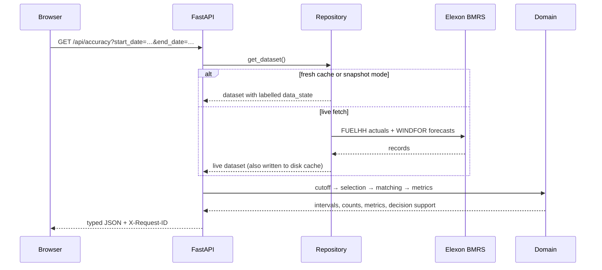

<div align="center">

# Gridbricks

**Look-ahead-free wind forecast analytics on real Elexon data.**

A full-stack decision-support pilot for a UK energy utility's day-ahead
procurement desk. It answers the two questions that matter before a forecast
is trusted:

> *Which wind forecast was actually available when the purchase decision had
> to be made?*
>
> *How close were those eligible forecasts to delivered generation?*

[](https://github.com/GauravKaloliya/Gridbricks/actions/workflows/ci.yml)
[](LICENSE)
[](https://www.python.org/)
[](https://react.dev/)
[](docs/deployment.md)
[](#docker)

[Quickstart](#quickstart) · [Deploy](#deploy) · [Architecture](#architecture) · [Results](#results-on-real-data) · [API](#api) · [Testing](#testing-and-evidence) · [Docs](#documentation)

</div>


---

## Why this exists

Wind output is weather-dependent and uncertain. A day-ahead procurement team
must commit before delivery, so it can only use forecasts that had already
been published at decision time. WINDFOR revisions arrive several times a day;
using a later revision in a historical analysis leaks future information into
the past and overstates what the desk could have known.

That is **look-ahead bias**, and it is the central engineering constraint of
this project.

Gridbricks makes the distinction explicit and auditable:

| Field | Meaning |
| --- | --- |
| `startTime` | The delivery interval the forecast or actual refers to |
| `publishTime` | When that particular forecast version became available |
| `generation` | Forecast or actual wind power in MW |
| **cutoff** | **09:30 Europe/London on the calendar day before delivery** |
| **selected forecast** | **Latest version with `publishTime <= cutoff`** |

Every screen shows which version was selected, when it was published, which
revisions were excluded, and what the resulting error was. A post-cutoff
forecast can never enter the metrics.

> The challenge does not specify a cutoff clock time. **09:30 is a documented,
> configurable assumption** chosen because it is a real observed WINDFOR
> publication time and provides a stable day-ahead decision point. It is not
> presented as a client rule.

This is a **wind-generation analytics pilot**, not a procurement optimiser: it
does not model demand, prices, other fuels, interconnectors, contracts, or
purchase volumes.

---

## Results on real data

January 2026, national wind generation. 744 hourly delivery intervals, all
matched to an eligible forecast and both half-hourly actuals.

| Measure | Result |
| --- | ---: |
| Matched intervals | **744 / 744** |
| MAE | **2,122.81 MW** |
| RMSE | **2,616.69 MW** |
| Mean signed error (MBE) | **+1,840.30 MW** |
| P90 absolute error | **4,312.40 MW** |
| P95 absolute error | **5,418.53 MW** |
| P90 generation shortfall | **488.85 MW** |
| Hours underforecast | **15.59%** |
| Lead-time buckets (`<18h`, `18–24h`, `24–30h`, `≥30h`) | **124 / 186 / 186 / 248** |

The positive MBE says the eligible forecasts ran **above** delivered
generation across the month; the P90 measures describe the bad tail that an
average hides. The mean is useful, but the shortfall distribution is what
reserve planning actually needs.

Source data: **1,488** half-hourly WIND actuals and **18,104** WINDFOR forecast
records across **744** target hours and **272** publication timestamps
(24–32 revisions per target hour). No synthetic values, no zero-filling, no
invented half-hourly forecasts.

---

## Product tour

| Overview | Forecast explorer |
| --- | --- |
| [](docs/screenshots/overview.png) | [](docs/screenshots/forecast-explorer.png) |
| Metrics, coverage, time series, provenance, cutoff explanation | Selected version, publication time, and every excluded revision |
| **Accuracy analysis** | **Data table** |
| [](docs/screenshots/accuracy-decision-support.png) | [](docs/screenshots/data-table.png) |
| Error distribution, definitions, lead-time buckets, largest misses | Hourly audit plus raw half-hourly FUELHH records, CSV export |

<p align="center">
  
</p>

### What the app does

- **Overview** — MAE, RMSE, signed error, coverage, forecast-versus-actual
  chart, period summary, data provenance, and the cutoff rule in plain language.
- **Forecast explorer** — pick a delivery day and hour; inspect the eligible
  forecast, its publication time, and the full revision history with
  post-cutoff versions visibly excluded. Largest-miss links deep-link here.
- **Accuracy analysis** — signed-error chart, data-quality counts, metric
  definitions, decision-support percentiles, lead-time decay, and an explicit
  no-data state.
- **Data table** — paginated hourly audit with delivery start, publication
  time, cutoff, forecast, actual, signed error, absolute error, and status
  reason. A second tab exposes the raw half-hourly FUELHH settlement periods.
- **CSV export** — the current interval table downloads as UTF-8 CSV with
  publication time, cutoff, lead time, status, and the reason any row is
  unavailable.
- **URL-backed state** — date range and selected forecast hour are query
  parameters, so every view survives reload and can be shared.
- **Traceable failures** — every response carries `X-Request-ID`; error
  envelopes repeat it and the UI shows it, so a failed call maps to one server
  log line.
- **Explicit data states** — loading, error, empty, partial, cache, live,
  snapshot, and fallback are visible. Unavailable values are never replaced
  with zero.
- **Mobile-first** — tables reflow to record cards; tested from 320 px upward.

---

## Quickstart

### One command with Docker

```bash
git clone https://github.com/GauravKaloliya/Gridbricks.git
cd Gridbricks
docker compose up --build
```

Open **<http://localhost:8080>**. The API is at **<http://localhost:8000>**
(`/health`, `/docs`).

For a deterministic demo backed by the bundled real Elexon snapshot:

```bash
DATA_MODE=snapshot docker compose up --build
```

If your Docker installation does not include the Compose plugin, use
`docker-compose up --build`.

### Local development

**Backend** (Python 3.11+; 3.12 is used in containers and CI):

```bash
cd backend
python3.12 -m venv .venv
source .venv/bin/activate
pip install -r requirements-dev.txt
uvicorn app.main:app --reload --host 127.0.0.1 --port 8000
```

**Frontend**:

```bash
cd frontend
npm ci
npm run dev
```

Open <http://127.0.0.1:5173>. In development the frontend defaults to
`http://localhost:8000`; in production it calls the same origin unless
`VITE_API_BASE_URL` is set.

The first live request fetches January 2026 from Elexon (about 2.5 MB) and
caches it under `backend/.cache/`. If the upstream is unreachable, the API
serves the bundled real-data snapshot, labelled `snapshot_fallback`.

### Rebuild the snapshot from Elexon

```bash
cd backend
source .venv/bin/activate
python -m scripts.build_snapshot
```

### Useful commands

| Command | What it does |
| --- | --- |
| `bash scripts/verify.sh` | Full local gate: backend, unit, build, budget, three-browser E2E, Docker smoke |
| `bash scripts/verify.sh --no-docker` | Same gate without rebuilding containers |
| `bash scripts/smoke.sh` | Build and assert the Compose stack in snapshot mode |
| `cd backend && python -m pytest -q` | Backend suite |
| `cd frontend && npx vitest run` | Frontend unit suite |
| `cd frontend && npm run test:e2e` | Playwright across Chromium, Firefox, WebKit |

---

## Deploy

### Vercel — one project, both services (recommended)

The repository ships a full-stack [Vercel Services](https://vercel.com/docs/services)
configuration in [`vercel.json`](vercel.json):

- `web` builds the Vite SPA from `frontend/`.
- `api` deploys the FastAPI app from `backend/` as a Python 3.12 function.
- `/api/*`, `/health`, `/docs`, and `/openapi.json` route to the API;
  everything else routes to the SPA.
- The deployed API runs in **snapshot mode** on a read-only filesystem, so it
  is deterministic and never depends on an upstream call.
- No CORS or `VITE_API_BASE_URL` configuration is required: both services share
  one origin.

[](https://vercel.com/new/clone?repository-url=https://github.com/GauravKaloliya/Gridbricks)

Or with the CLI:

```bash
npm i -g vercel
vercel link
vercel --prod
```

Full steps, verification commands, and limits:
[`docs/deployment.md`](docs/deployment.md).

### Split deployment

If you prefer separate hosts:

- **Frontend** — Vercel, root directory `frontend/`, `VITE_API_BASE_URL=https://<api-host>`.
  [`frontend/vercel.json`](frontend/vercel.json) carries the build and SPA rewrite.
- **Backend** — any Docker host (`backend/Dockerfile` binds `$PORT`). The
  repository includes a [`render.yaml`](render.yaml) blueprint and a Heroku
  container workflow. Set `ALLOWED_ORIGINS` to the exact frontend origin.

> **Deployment status:** the configuration is committed and has been exercised
> locally with `vercel dev --local` and the Docker smoke. **No public URL is
> claimed yet** — creating the Vercel project and deploying is a manual step
> for the repository owner.

---

## Architecture

```text
Browser
   │  HTTPS
   ▼
┌─────────────────────────────────────────────────────────────┐
│ React 19 + TypeScript + Vite                                │
│ TanStack Query · React Router · Recharts · Tailwind CSS     │
│ pages/components → services/api.ts → /api/...               │
└──────────────────────────────┬──────────────────────────────┘
                               │ one origin on Vercel
┌──────────────────────────────▼──────────────────────────────┐
│ FastAPI (Python 3.12)                                       │
│ api/routes.py        validation + typed response models     │
│ services/analysis.py range resolution + orchestration       │
│ domain/              cutoff → selection → matching → metrics│
│ data/repository.py   live fetch → disk cache → snapshot     │
└──────────────────────────────┬──────────────────────────────┘
                               │ HTTPS (live mode)
┌──────────────────────────────▼──────────────────────────────┐
│ Elexon BMRS public API                                      │
│ FUELHH  half-hourly wind actuals (WIND)                     │
│ WINDFOR hourly wind forecasts with publication timestamps   │
└─────────────────────────────────────────────────────────────┘
```

The boundaries are deliberate:

- **Data client** handles HTTP, pagination, and upstream error translation only.
- **Normalization** lives in Pydantic schemas: timezone-aware UTC timestamps,
  rejection of non-finite or negative generation.
- **Domain logic** is pure and independent of HTTP, React, and storage:
  cutoff, selection, actual aggregation, matching, metrics.
- **API layer** validates ranges, chooses status codes, and returns typed models.
- **Frontend** presents backend results; it does not reimplement forecast
  selection or metric math.

A single accuracy request:



Every response carries a request id. Error envelopes repeat it as
`request_id`, and the server access log records method, path, status,
duration, and id on one line.

---

## Data and correctness

### Sources

Both datasets are public Elexon BMRS endpoints and require no API key.

| Dataset | Endpoint | Fields used | Role |
| --- | --- | --- | --- |
| **FUELHH** | `GET /bmrs/api/v1/datasets/FUELHH` | `fuelType`, `startTime`, `generation` | Actual half-hourly wind generation |
| **WINDFOR** | `GET /bmrs/api/v1/datasets/WINDFOR` | `startTime`, `publishTime`, `generation` | Hourly forecast versions |

Verified upstream behavior (details in
[`docs/elexon-api-notes.md`](docs/elexon-api-notes.md)):

- The working query parameters are `publishDateTimeFrom` /
  `publishDateTimeTo`, and they filter by **publication time**, not delivery
  time. The backend pads the query window and filters locally by `startTime`.
- A single publication window may not exceed 7 days; requests are chunked into
  5-day windows.
- FUELHH contains 20 fuel types; only `fuelType == "WIND"` is retained.
- WINDFOR is **hourly**, FUELHH is **half-hourly**. Forecasts are never
  downsampled or invented at half-hour resolution.
- Generation values are in **MW**.

### Forecast selection (no look-ahead)

For each hourly delivery interval, `backend/app/domain/selection.py`:

1. Keeps forecast records whose `startTime` equals the target hour.
2. Keeps only records with `publishTime <= cutoff`.
3. Selects the record with the latest `publishTime`.
4. Returns `missing_forecast` with a null forecast if none is eligible.
5. Treats identical duplicates as one version; conflicting duplicates for the
   same publication time become `invalid_record`.
6. Preserves publication time, eligibility count, and cutoff for audit.

Tests cover the exact-cutoff boundary, post-cutoff rejection, duplicates, and
the no-eligible-forecast case.

### Matching and missing data

- Each forecast hour is paired with the **mean of its two half-hourly actuals**.
- **Both halves must be present.** If either is missing, the interval is
  `missing_actual` and excluded from metrics.
- A missing value is never treated as zero, and no half-hourly forecast is
  invented.
- Duplicate actuals are aggregated deterministically; conflicting duplicates
  make the interval invalid.
- Status priority: `invalid_record` → `missing_forecast` → missing/invalid
  actual → `matched`.

### Metrics

Signed error is **forecast − actual**, in MW:

| Metric | Definition | Interpretation |
| --- | --- | --- |
| Signed error | `forecast − actual` | Positive = overforecast; negative = underforecast |
| Absolute error | `abs(forecast − actual)` | Magnitude of the miss |
| MAE | mean of absolute errors | Average miss; lower is better |
| RMSE | `sqrt(mean(error²))` | Penalises large misses more than MAE |
| MBE | mean of signed errors | Persistent positive value = systematic overforecast |
| P90/P95 absolute error | Percentile with linear interpolation | How bad a bad hour looks |
| P90 shortfall | 90th percentile of `max(actual − forecast, 0)` over all matched hours | Under-delivery implied by a P90 hour |
| Underforecast share | Share of matched hours where `actual > forecast` | How often, not how much |
| Lead-time MAE/bias | Buckets `<18h`, `18–24h`, `24–30h`, `≥30h` | Whether accuracy decays with forecast age |

- Only matched intervals with finite values contribute.
- No matched pairs returns `status: "no_data"`, `null` metrics, and a matched
  count of 0 — never a false zero.
- MAPE is intentionally omitted: actual wind generation can be zero or near
  zero, making relative error unstable.
- Percentiles are descriptive statistics over 744 hours, not calibrated
  probabilities or a reserve policy.

The full rationale for cutoff semantics, tie handling, matching, percentile
method, and missing-data policy is in
[`docs/decisions.md`](docs/decisions.md).

---

## API

Local base URL: `http://localhost:8000`. Interactive OpenAPI docs: `/docs`.

| Method | Endpoint | Purpose |
| --- | --- | --- |
| `GET` | `/health` | Liveness, version, and configured data mode |
| `GET` | `/api/meta` | Period, cutoff rule, attribution, disclaimer |
| `GET` | `/api/accuracy?start_date=…&end_date=…` | Metrics, decision support, counts, interval rows |
| `GET` | `/api/forecasts?start_date=…&end_date=…` | Selected forecasts and eligibility metadata |
| `GET` | `/api/actuals?start_date=…&end_date=…` | Raw WIND actuals plus hourly aggregates |
| `GET` | `/api/forecast-revisions?start_time=…` | Every revision for one delivery hour |

Dates are inclusive delivery dates within January 2026. Ranges longer than 31
days, inverted ranges, and dates outside the analysis period return structured
`INVALID_REQUEST` or `OUT_OF_ANALYSIS_PERIOD` errors.

```bash
curl -s "http://localhost:8000/api/accuracy?start_date=2026-01-01&end_date=2026-01-31" \
  | python3 -c 'import json,sys; d=json.load(sys.stdin); print(d["metrics"])'
```

Full request/response examples: [`docs/api.md`](docs/api.md).

---

## Engineering decisions

The choices that change the numbers are recorded with their trade-offs in
[`docs/decisions.md`](docs/decisions.md):

- Latest forecast published **at or before** the cutoff wins; conflicting
  duplicates are invalid rather than resolved arbitrarily.
- Hourly forecasts are compared with the **mean of both half-hourly actuals**.
- Missing values are **excluded, never zero-filled**.
- Signed error is **forecast − actual**.
- Percentiles use linear interpolation and include zero-shortfall hours.
- The bundled snapshot is **real Elexon data** and is always labelled as a
  snapshot.
- No database: the bounded January dataset fits comfortably in memory; a disk
  cache plus provenance-stamped snapshot is sufficient for this pilot.
- The deployed Vercel API uses snapshot mode because serverless filesystems are
  read-only; the container deployment can use live fetch, cache, and fallback.

---

## Testing and evidence

| Layer | Result | Command |
| --- | --- | --- |
| Backend | **78 passed** | `cd backend && python -m pytest -q` |
| Frontend unit | **42 passed** | `cd frontend && npx vitest run` |
| Unit typecheck | **clean** | `cd frontend && npx tsc --noEmit` |
| End-to-end | **22 passed, 8 skipped, 30 runs** | `cd frontend && npm run test:e2e` |
| Accessibility | **axe on all four routes (Chromium)** | `cd frontend && npm run test:e2e` |
| Container smoke | **passed** | `bash scripts/smoke.sh` |
| Bundle budget | **500 kB max chunk** | `cd frontend && node scripts/check-bundle-budget.mjs` |
| Full local gate | **passed** | `bash scripts/verify.sh` |

What the suites cover:

- **Backend** — cutoff boundaries and DST, latest-eligible selection,
  post-cutoff rejection, duplicate handling, missing forecasts/actuals, metric
  arithmetic, decision-support percentiles and lead-time buckets, empty
  datasets, upstream retries, API status codes and schemas, snapshot
  validation, cache fallback and TTL expiry, oversized ranges, request-id
  propagation, unexpected 500 envelopes, and standardised 404/405 errors. A
  snapshot-invariant suite loads the real 2.4 MB file and locks the full-month
  counts, MAE/RMSE/MBE, percentiles, and bucket partition to the documented
  values.
- **Frontend** — formatting and timezone display, date-range normalisation,
  loading/error/empty/partial/fallback states, data-table rendering, the
  half-hourly actuals table, decision support, CSV quoting, API client URL
  validation and error mapping, and Overview page states.
- **Playwright** — tooltip tracking without animated drift, full-month
  selection and navigation, forecast revision audit, accuracy metrics and
  decision support, largest-miss deep links, tab switching, CSV download, an
  aborted-API/retry recovery path, and axe checks that fail on any critical or
  serious violation. Six functional flows run on Chromium, Firefox, and WebKit;
  four axe cases run on Chromium.
- **CI** — [`.github/workflows/ci.yml`](.github/workflows/ci.yml) runs four
  jobs: backend pytest, frontend typecheck + Vitest + build + bundle budget,
  the three-browser Playwright suite, and a container build + Compose smoke.
  The E2E and container jobs depend on the first two.

The local gate and Docker smoke were executed on this machine, and the hosted
GitHub Actions run passed all four jobs. The first hosted run also caught a
Linux-only bug in the smoke script that the local gate could not reproduce —
the full-month JSON was too large to pass as a command-line argument — which
was fixed before the green run. The evidence ledger, including exact outputs
and known gaps, is
[`docs/implementation-status.md`](docs/implementation-status.md).

---

## Repository guide

```text
.
├── backend/
│   ├── app/
│   │   ├── api/routes.py          # /health, /api/meta, /api/accuracy, ...
│   │   ├── core/                  # settings, logging, request ids, errors
│   │   ├── data/                  # Elexon client, repository, snapshot store
│   │   ├── domain/                # cutoff, selection, matching, metrics
│   │   ├── schemas/models.py      # typed API contracts
│   │   ├── services/analysis.py   # orchestration and documented rules
│   │   ├── main.py                # FastAPI app, CORS, error handlers
│   │   └── vercel.py              # Vercel entrypoint (snapshot mode)
│   ├── data/snapshot_january_2026.json  # real Elexon Jan 2026 snapshot
│   ├── scripts/build_snapshot.py  # regenerates the snapshot from live data
│   ├── tests/                     # 78 backend tests
│   ├── requirements.txt           # runtime dependencies
│   ├── requirements-dev.txt       # runtime + pytest/respx
│   ├── .python-version            # 3.12 for Vercel
│   └── Dockerfile                 # binds $PORT, 8000 locally
├── frontend/
│   ├── src/
│   │   ├── components/            # layout, charts, tables, decision panel, CSV
│   │   ├── hooks/useAnalytics.ts  # TanStack Query hooks
│   │   ├── lib/                   # formatting, CSV serialisation
│   │   ├── pages/                 # Overview, Forecast explorer, Accuracy, Data
│   │   ├── services/api.ts        # typed API client and error mapping
│   │   └── types/api.ts
│   ├── e2e/                       # functional flows + axe checks
│   ├── scripts/check-bundle-budget.mjs
│   ├── vercel.json                # standalone frontend deployment
│   └── Dockerfile
├── docs/
│   ├── api.md                     # endpoint reference with examples
│   ├── decisions.md               # trade-offs behind the numbers
│   ├── deployment.md              # Vercel Services and split-deploy runbook
│   ├── demo-script.md             # ≤10-minute demo outline
│   ├── elexon-api-notes.md        # verified upstream behaviour
│   ├── implementation-plan.md     # plan, risks, traceability
│   ├── implementation-status.md   # evidence ledger and known gaps
│   └── screenshots/
├── scripts/
│   ├── verify.sh                  # CI-equivalent local gate
│   └── smoke.sh                   # builds and asserts the Compose stack
├── .github/workflows/ci.yml
├── docker-compose.yml
├── render.yaml                    # backend container blueprint
├── vercel.json                    # one-project Vercel Services config
├── .vercelignore
├── .env.example
└── LICENSE
```

---

## Configuration

Backend (root `.env` or `backend/.env`; see [`.env.example`](.env.example)):

| Variable | Default | Meaning |
| --- | --- | --- |
| `ELEXON_BASE_URL` | `https://data.elexon.co.uk/bmrs/api/v1` | Upstream API base |
| `ANALYSIS_START` / `ANALYSIS_END` | `2026-01-01` / `2026-01-31` | Supported delivery period |
| `DECISION_CUTOFF_TIME` | `09:30` | Local cutoff clock time |
| `DECISION_CUTOFF_TZ` | `Europe/London` | Cutoff timezone |
| `DECISION_CUTOFF_INCLUSIVE` | `true` | `publishTime <= cutoff` |
| `DATA_MODE` | `live` | `live` fetch/cache/fallback or `snapshot` only |
| `SNAPSHOT_PATH` | `data/snapshot_january_2026.json` | Stored real-data snapshot |
| `CACHE_DIR` | `.cache` | Disk cache directory |
| `CACHE_TTL_SECONDS` | `604800` | Cache freshness window (7 days) |
| `ALLOWED_ORIGINS` | `http://localhost:5173,http://127.0.0.1:5173` | CORS allow-list |
| `UPSTREAM_TIMEOUT_SECONDS` | `30` | Per-request upstream timeout |
| `UPSTREAM_MAX_RETRIES` | `3` | Bounded retries for transient failures |
| `MAX_RANGE_DAYS` | `31` | Maximum API date range |

Frontend (`.env.local`; see [`frontend/.env.example`](frontend/.env.example)):

| Variable | Default | Meaning |
| --- | --- | --- |
| `VITE_API_BASE_URL` | unset → same origin (production), `http://localhost:8000` (dev) | Analytics API base URL |

No secrets or API keys are required for these public Elexon endpoints. `.env`
files are ignored by Git; only the examples are committed.

---

## Docker

`docker-compose.yml` builds and runs both services:

```bash
docker compose up --build
```

- Frontend: **<http://localhost:8080>**
- Backend: **<http://localhost:8000>** (`/health`, `/docs`)
- Host ports are configurable: `API_PORT=8030 WEB_PORT=8090 docker compose up`.
- The backend binds `$PORT` when the platform provides one, falling back to
  `8000`; the same image deploys unchanged.
- CORS defaults to `http://localhost:8080` and `http://127.0.0.1:8080`;
  override `ALLOWED_ORIGINS` for another origin.
- The API URL is compiled into the frontend at build time via
  `VITE_API_BASE_URL` (`PUBLIC_API_URL` build argument); rebuild if it changes.
- Both containers have healthchecks and the frontend waits for the backend.

`scripts/smoke.sh` builds the images, boots snapshot mode, asserts the
full-month API payload (744/744, MAE, P90 shortfall, bucket partition), the SPA
shell and deep link, CORS, request ids, and both health states, then tears the
stack down. It is the final stage of `scripts/verify.sh`.

---

## Known limitations

- **Wind only.** No demand, price, other generation, interconnector, contract,
  or procurement-volume modelling.
- **January 2026 only.** The API rejects dates outside 2026-01-01–2026-01-31
  and ranges longer than 31 days.
- **Cutoff is an assumption.** 09:30 Europe/London on the previous day is
  configurable and documented, not a client-specified rule.
- **Resolution asymmetry.** Forecasts are hourly and actuals half-hourly;
  accuracy is computed on hours using the mean of two actuals.
- **Snapshot age.** The bundled snapshot is frozen at retrieval time. Live mode
  refreshes from Elexon and labels cache/fallback states explicitly.
- **Cache is per-instance.** No shared cache or database; multiple replicas
  would each fetch or parse independently.
- **No authentication.** The app is read-only and uses public data. If exposed
  publicly, upstream rate limits and hosting quotas still apply.
- **Browser coverage.** Functional flows run in Chromium, Firefox, and WebKit;
  layout was checked at 320–1440 px. Axe runs on Chromium only, and real mobile
  devices and a screen-reader session were not tested.
- **Vercel Services is Beta.** The one-project deployment is documented and
  locally exercised; a public deployment URL is not yet live.
- **Decision support is descriptive.** P90/P95 error and shortfall describe
  the measured 744 hours; they are not calibrated probabilities from an
  ensemble forecast and are not a reserve policy.
- **Elexon revisions.** Upstream historical revisions may change; the app
  analyses what the API returns at fetch time and records `retrieved_at`.

---

## What I'd do next

1. **Naive baseline.** Show MAE beside last-value or seasonal-naive forecasts,
   so "2.1 GW MAE" has a reference point.
2. **Cost, not just MW.** Join shortfall hours to imbalance prices and procured
   volume, converting P90 shortfall into expected £ exposure.
3. **Probabilistic calibration.** Compare measured P90/P95 errors with
   published quantiles or ensembles; report reliability diagrams.
4. **Shared cache and materialised aggregates.** Replace the per-instance JSON
   cache with Redis/S3 and pre-compute daily metrics.
5. **Operational concerns.** Authentication, saved views, edge rate limiting,
   metrics export, and alerting on upstream freshness and coverage drops.
6. **Close the deployment loop.** Create the Vercel project, run the
   Playwright/axe suite against the deployed URL, and deploy only from green CI.

---

## AI development disclosure

AI coding assistance (Qoder) was used to help design, implement, test, and
document this project. All generated code was inspected and executed locally:
backend tests, frontend tests, production builds, live Elexon retrieval, browser
verification, Docker smoke, and the Vercel Services configuration. The
delivered application contains **no AI model or runtime AI API calls**; AI
assistance was development-time only, as permitted by the challenge.

## Documentation

- [Verified Elexon API behaviour](docs/elexon-api-notes.md)
- [Engineering decision log](docs/decisions.md)
- [API reference with examples](docs/api.md)
- [Deployment runbook](docs/deployment.md)
- [Implementation plan and traceability](docs/implementation-plan.md)
- [Implementation status and verification evidence](docs/implementation-status.md)
- [Demo video outline](docs/demo-script.md)

## License

[MIT](LICENSE) © 2026 Gaurav Kaloliya

Data attribution: contains public Elexon BMRS data (FUELHH and WINDFOR).
